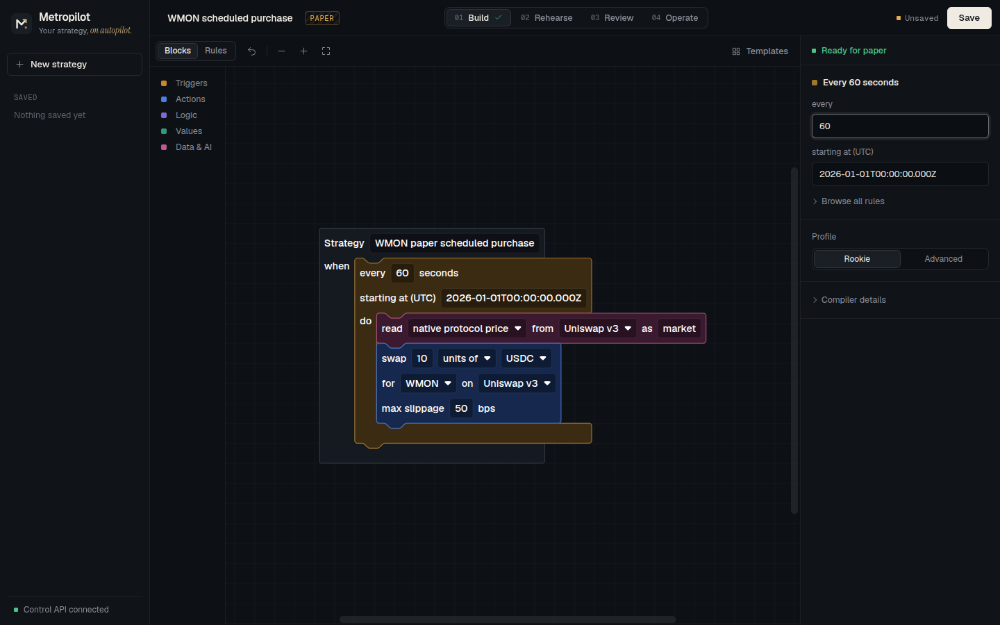
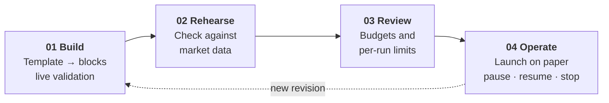
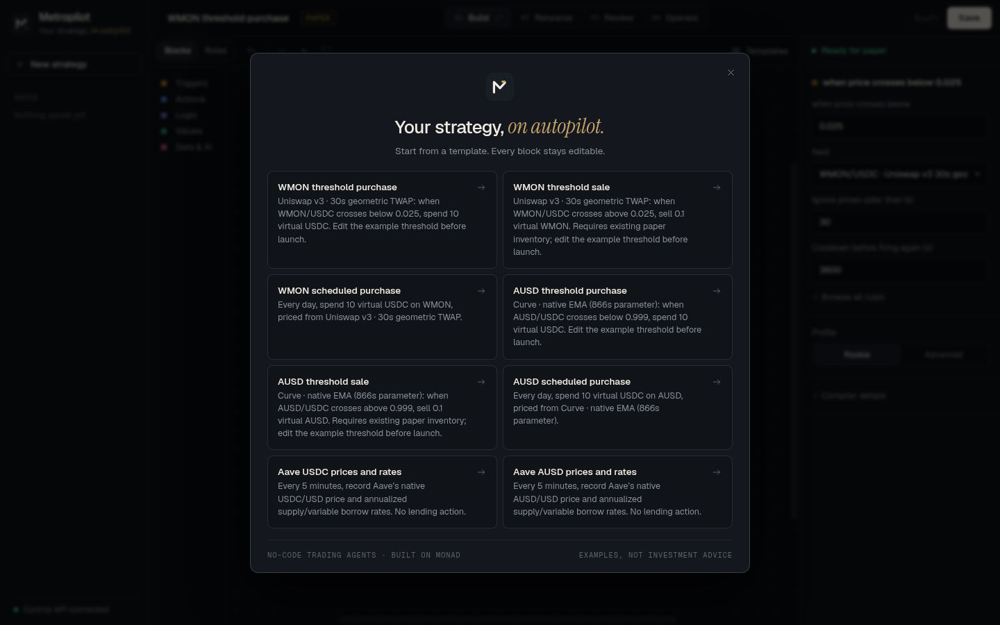
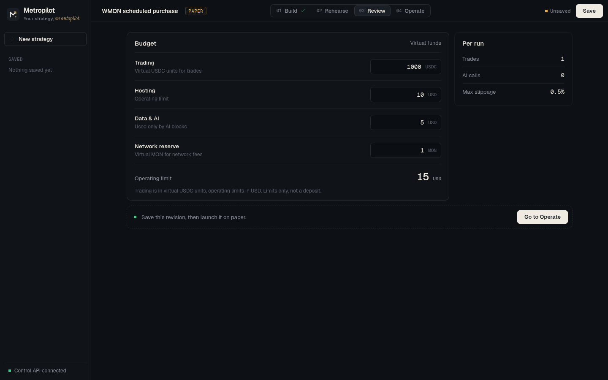
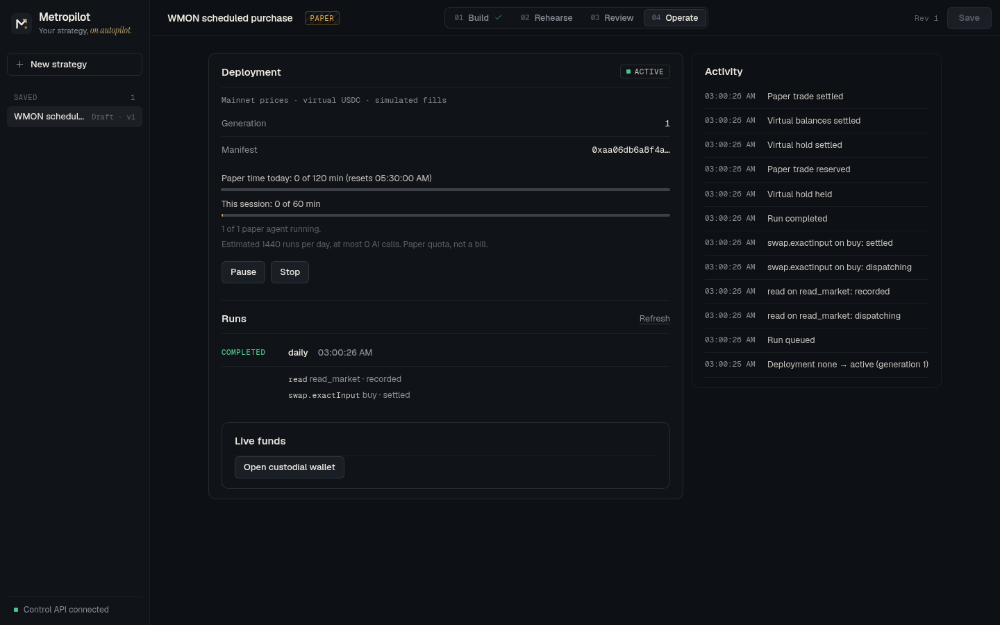
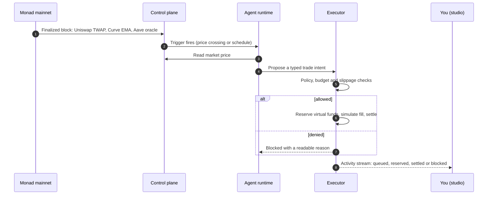
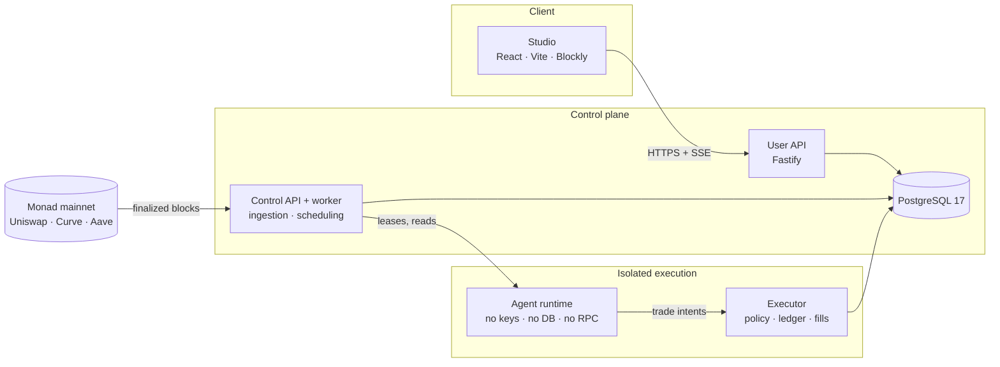

<p align="center">
  
</p>

<p align="center">
  <strong>No-code trading agents on Monad.</strong><br />
  Build a strategy from blocks, run it against live Monad market data, and keep every action inside limits you set.
</p>

<p align="center">
  
  
  
  
</p>

<p align="center">
  <a href="#quick-start">Quick start</a> ·
  <a href="#how-it-works">How it works</a> ·
  <a href="#status">Status</a> ·
  <a href="#architecture">Architecture</a> ·
  <a href="#documentation">Documentation</a>
</p>

> [!NOTE]
> Metropilot runs today as a **local paper stack**: prices are real, finalized Monad mainnet observations; balances are virtual and fills are simulated. No real funds move. Hosting and capped live trading are in progress — see [Status](#status).

<p align="center">
  
</p>

## Why Metropilot

Running a trading agent today means renting servers, wiring model APIs, writing protocol code and trusting a wallet setup you assembled yourself. Metropilot replaces all of that with one workspace.

| Benefit | What it means for you |
| --- | --- |
| **No code, no servers, no keys** | Start from a template, edit it as blocks or plain forms, and launch. Isolation, market data and execution are provided. |
| **Real market data** | Strategies react to finalized Monad mainnet prices from Uniswap, Curve and Aave — not a synthetic feed. |
| **Guardrails you can see** | Budgets, per-run limits and slippage caps are checked as you type, again by the server on save, and again by the executor before any fill. |
| **You stay in control** | Every save is an immutable revision. Pause, resume or stop at any time, and follow each step in a live activity stream. |

## How it works

A strategy moves through four stages. Each one is a tab in the studio.



| Stage | What you do | What the platform guarantees |
| --- | --- | --- |
| **Build** | Pick one of 8 templates, then edit blocks: triggers, reads, conditions, swaps, bounded AI decisions | The compiler validates every change; problems link straight to the field to fix |
| **Rehearse** | Check how the strategy reads its markets | Native oracle methods are explained; scenario playback for them is not available yet |
| **Review** | Set trading, hosting and AI budgets plus the network reserve | Trading funds are virtual USDC units (max 10,000); operating limits are USD; nothing is a deposit |
| **Operate** | Save a revision and launch it on paper | The launch shows exactly what the agent may do; runs, trades and denials stream live |

<table>
  <tr>
    <td width="50%"><br /><sub><b>Start from a template.</b> Eight editable strategies across Uniswap, Curve and Aave.</sub></td>
    <td width="50%"><br /><sub><b>Set the boundaries.</b> Separate trading, hosting and AI budgets with per-run limits.</sub></td>
  </tr>
  <tr>
    <td colspan="2"><br /><sub><b>Run it on paper.</b> A real run from the local stack: the agent read the Uniswap TWAP, reserved virtual USDC and settled a simulated fill.</sub></td>
  </tr>
</table>

### What happens on every run

The agent never holds keys or spends directly. It proposes; a separate executor decides.



## Supported markets

All sources are Monad mainnet (chain 143), read from finalized blocks. Thresholds in templates are editable examples, not quotes or recommendations.

| Venue | Market | Price method | Agent can |
| --- | --- | --- | --- |
| **Uniswap v3** | WMON / USDC | 30-second geometric TWAP | Read price · paper swap |
| **Curve** StableSwap-NG | AUSD / USDC | Native EMA (866 s) | Read price · paper swap |
| **Aave v3** | USDC, AUSD | Native USD oracle + supply / variable-borrow APR | Read only |

Pool addresses, discovery and finality probes: [market data sources](docs/research/market-data-sources.md) · connector scope: [connectors](docs/specs/connectors.md#selected-connectors-2026-10-12).

## Safety model

- **Propose, then authorize.** The runtime interprets your strategy and proposes; only the executor can reserve funds or settle, after deterministic policy checks.
- **Configuration is data.** Strategies are bounded JSON compiled from blocks — no scripts, URLs, API keys or wallet keys ever enter a strategy, manifest or export.
- **Atomic budgets.** Every trade reserves funds per asset in one database transaction; concurrent overspend fails.
- **Paper and live never mix.** Separate identities, balances and effects; a simulated fill is never shown as an on-chain transaction.
- **Ambiguity is not success.** A timed-out external call is reconciled, never assumed to have had no effect.
- **Honest custody.** Agent wallets are platform-controlled, and described that way.

Full rules: [security](docs/specs/security.md) · [funds and budgets](docs/specs/funds-and-budgets.md) · [executor](docs/specs/executor.md).

## Status

| Capability | Status | Evidence |
| --- | --- | --- |
| Strategy studio: templates, blocks, keyboard forms, live validation | Working | Playwright browser tests in [apps/web/e2e](apps/web/e2e/) |
| Full local paper stack on live mainnet prices | Working | `pnpm stack:dev`; first run 8 s after launch (2026-10-14) |
| Launch, pause, resume, stop, run history, live activity, paper quotas | Working (local) | [operate.spec.ts](apps/web/e2e/operate.spec.ts), [paper-stack.test.ts](tests/paper-stack.test.ts) |
| Ledger, atomic reservations, allocations, withdrawals | Working (local chain) | [funds guide](docs/integration/funds.md) |
| Privy server-wallet custody | Proven on Monad testnet, 9/9 checks (2026-10-13) | [decisions E03](docs/decisions.md) |
| Alchemy as a second RPC witness | Proven, 6/6 checks (2026-10-13) | [decisions E06 / D60](docs/decisions.md) |
| Hosted deployment and sign-in | In progress | [goals G3–G4](goals.md) |
| Metered AI decisions (Kimi) | In progress | [goals G6](goals.md), [Kimi broker](docs/integration/kimi-broker.md) |
| Capped live trading | Planned | [goals G8](goals.md) |

Delivery gates and their exit criteria live in [goals.md](goals.md).

## Quick start

**Requirements:** Docker, [pnpm](https://pnpm.io) 12.8.1 (it downloads the pinned Node 24.21 for you), and internet access to `rpc.monad.xyz`.

```sh
git clone git@github.com:AnInsaneJimJam/monad-hack.git && cd monad-hack
cp .env.example .env        # set a new POSTGRES_PASSWORD and the same value in DATABASE_URL
pnpm bootstrap              # install, start Postgres, migrate, seed, run every check
pnpm stack:dev              # start the full local paper stack
```

Open **http://127.0.0.1:5173**, then try it in under a minute:

1. **New strategy** → **WMON scheduled purchase**.
2. In the right panel, set **every** to `60` seconds.
3. **Save**, open **Operate**, click **Launch on paper**.
4. Watch **Runs** and **Activity**: the first run completes within 60 seconds.

| Service | Port | Role |
| --- | --- | --- |
| Studio | 5173 | React + Blockly web app |
| User API | 3001 | Strategies, revisions, launches, history |
| Control API + worker | 3002 | Mainnet ingestion, scheduling, runtime leases |
| Paper executor | 3003 | Policy checks, reservations, simulated fills |
| PostgreSQL 17 | 5432 | Source of truth (Docker) |

<details>
<summary><b>Everyday commands</b></summary>

| Command | Effect |
| --- | --- |
| `pnpm check` | Regenerate schema types, strict typecheck, every test suite (`REQUIRE_DB=1` to fail without a database) |
| `pnpm --filter @monad-hack/web test:e2e` | Playwright browser tests |
| `pnpm web:dev` | Studio only, without the backend |
| `pnpm db:migrate` / `pnpm db:seed` | Apply new migrations / load paper seed data |
| `pnpm db:reset` | Delete the local database volume (run `pnpm bootstrap` again after) |
| `pnpm market:probe` | Read-only check of the finalized mainnet sources |
| `pnpm alchemy:check` | Compare Alchemy with the public Monad RPC |

</details>

<details>
<summary><b>Optional configuration</b></summary>

All values go in your git-ignored `.env`; see [.env.example](.env.example) for the full list.

| Variable | Purpose |
| --- | --- |
| `MARKET_RPC_URL`, `MARKET_WS_URL` | Use an Alchemy Monad mainnet endpoint for market data. On the free tier also set `MARKET_LOG_SPAN=10`, `MARKET_RPC_MAX_RPS=15`, `MARKET_PUSH_MIN_MILLIS=2500` |
| `CUSTODY_PROVIDER` | `local` (default in `stack:dev`) for the labelled in-process chain; `privy` with your own Privy app for testnet custody |
| `CUSTODY_RPC_SECONDARY` | Second RPC witness: deposits credit and withdrawals settle only when both providers agree |
| `DEMO_KIMI` | Register the paper Kimi profile for AI blocks (broker verification still required) |

Secrets live only in `.env` or a hosting secret store. `pnpm check` scans tracked files for credential-shaped content.

</details>

## Architecture

A modular TypeScript control plane with separately isolated runtime and executor processes. PostgreSQL is the source of truth for configuration, jobs, events, ledger entries and reservations.



The browser never reaches the runtime or the executor. The runtime starts with a closed configuration and refuses database URLs, secrets and provider keys; its capability is scoped to one agent, one deployment generation and one mode. Design rationale: [architecture.md](architecture.md).

| Path | Responsibility |
| --- | --- |
| [`apps/web`](apps/web) | Studio: templates, Blockly editor, review, operate |
| [`apps/api`](apps/api) | User API, control API, ingestion worker, migrations |
| [`apps/runtime`](apps/runtime) | Strategy interpreter host; cannot sign or spend |
| [`apps/executor`](apps/executor) | Authorization, reservations, paper fills, reconciliation |
| [`packages/strategy`](packages/strategy) | Block vocabulary, compiler, deterministic interpreter |
| [`packages/contracts`](packages/contracts) | Versioned JSON schemas and generated types |
| [`packages/connectors`](packages/connectors) | Reviewed Monad markets and protocol reads |
| [`packages/accounting`](packages/accounting) · [`policy`](packages/policy) · [`custody`](packages/custody) | Ledger and reservations · authorization rules · wallet providers |

**Stack:** TypeScript (strict), Node 24 LTS, React 19 + Vite, Blockly 13, Fastify, PostgreSQL 17 with explicit SQL, JSON Schema 2020-12.

## Built with

| Partner | Role in Metropilot |
| --- | --- |
| **[Monad](https://monad.xyz)** | Chain for market data today and capped live trades next |
| **[Uniswap](https://uniswap.org) · [Curve](https://curve.fi) · [Aave](https://aave.com)** | Native price methods and reserve data on Monad mainnet |
| **[Alchemy](https://www.alchemy.com)** | Second RPC witness for custody; optional market transport |
| **[Privy](https://www.privy.io)** | Server wallets for agent custody (testnet proof complete) |
| **[Kimi](https://www.moonshot.ai)** | Bounded AI decisions via the broker (in progress) |

Sponsor evidence and priorities: [docs/research/sponsors.md](docs/research/sponsors.md).

## Documentation

| Read | For |
| --- | --- |
| [CONTEXT.md](CONTEXT.md) | Domain vocabulary |
| [architecture.md](architecture.md) | Stack, deployment shape, trust boundaries, end-to-end flows |
| [goals.md](goals.md) · [plan.md](plan.md) | Delivery gates and status · workstreams and ownership |
| [docs/README.md](docs/README.md) | Index of product, language, financial, runtime and interface specs |
| [docs/specs/control-workspace.md](docs/specs/control-workspace.md) | Studio setup, contracts and integration boundaries |
| [docs/specs/executor.md](docs/specs/executor.md) · [agent-runtime.md](docs/specs/agent-runtime.md) | Executor and runtime contracts, recovery |
| [docs/decisions.md](docs/decisions.md) | Settled decisions and external verification evidence |
| [design.md](design.md) | Repository policy, ownership and interfaces |

## Contributing

Read [AGENTS.md](AGENTS.md) and the nearest scoped `AGENTS.md` before editing — every directory has one with its checklist. Claim your scope in [plan.md](plan.md), keep `pnpm check` green, and tick a task only with linked evidence. Never commit credentials, private keys, user prompts or wallet exports.

---

<sub>Metropilot is a working product name; the repository is <code>monad-hack</code>. Paper mode uses virtual funds and simulated fills. Nothing here is investment advice, and the platform does not promise profitable trading.</sub>
