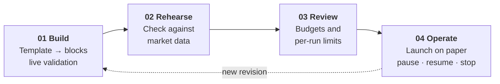
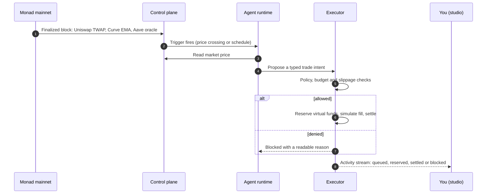
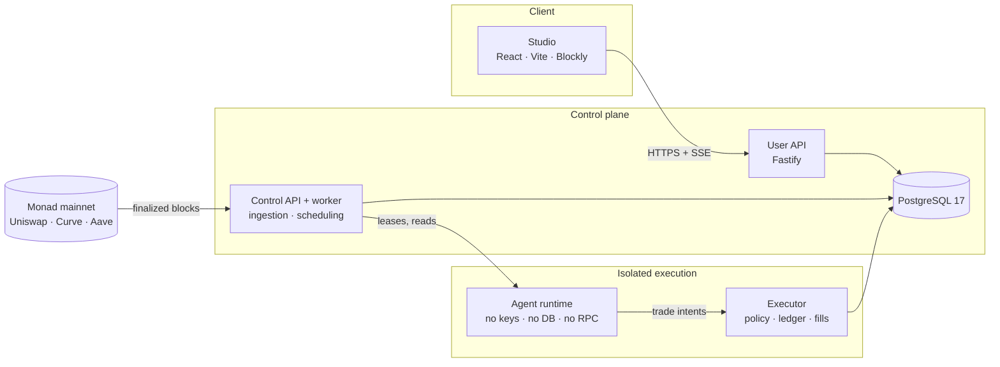

<p align="center">
  
</p>

<p align="center">
  <strong>No-code trading agents on Monad.</strong><br />
  Build a strategy from blocks, run it against live Monad market data, and keep every action inside limits you set.
</p>

<p align="center">
  
  
  
  
</p>

<p align="center">
  <a href="#quick-start">Quick start</a> ·
  <a href="#how-it-works">How it works</a> ·
  <a href="#architecture">Architecture</a> ·
  <a href="#documentation">Documentation</a>
</p>

## What is Metropilot

Automated trading is still built for engineers. To run even a simple rule, like "buy a little WMON every day" or "sell some when the price passes a level", you have to write code, rent a server, connect to market data and exchanges, and keep a wallet safe while it all runs unattended.

Metropilot removes that work. You describe the rule with drag-and-drop blocks or a ready-made template, set how much it may spend, and launch it. Metropilot runs it on Monad, watches the market for you, and checks every trade against your limits before it happens.

<p align="center">
  
</p>

## Why Metropilot

No code, no servers and no keys to manage: you build with blocks and Metropilot runs the agent. Strategies react to real Monad market data, every trade is checked against the budgets and limits you set, and you can pause or stop an agent at any time.

## How it works

A strategy moves through four stages. Each one is a tab in the studio.



| Stage | What you do | What the platform guarantees |
| --- | --- | --- |
| **Build** | Pick one of 8 templates, then edit blocks: triggers, reads, conditions, swaps, bounded AI decisions | The compiler validates every change; problems link straight to the field to fix |
| **Rehearse** | Check how the strategy reads its markets | Native oracle methods are explained; scenario playback for them is not available yet |
| **Review** | Set trading, hosting and AI budgets plus the network reserve | Trading funds are virtual USDC units (max 10,000); operating limits are USD; nothing is a deposit |
| **Operate** | Save a revision and launch it on paper | The launch shows exactly what the agent may do; runs, trades and denials stream live |

<table>
  <tr>
    <td width="50%"><br /><sub><b>Start from a template.</b> Eight editable strategies across Uniswap, Curve and Aave.</sub></td>
    <td width="50%"><br /><sub><b>Set the boundaries.</b> Separate trading, hosting and AI budgets with per-run limits.</sub></td>
  </tr>
  <tr>
    <td colspan="2"><br /><sub><b>Run it on paper.</b> A real run from the local stack: the agent read the Uniswap TWAP, reserved virtual USDC and settled a simulated fill.</sub></td>
  </tr>
</table>

### What happens on every run

The agent never holds keys or spends directly. It proposes; a separate executor decides.



## Supported markets

Agents read live, finalized Monad mainnet prices from **Uniswap v3** (WMON/USDC, 30-second TWAP) and **Curve** (AUSD/USDC, native EMA) and can paper-trade both; **Aave v3** USDC and AUSD prices and lending rates are available as read-only data. Details: [market data sources](docs/research/market-data-sources.md).

## Safety model

- **Propose, then authorize.** The runtime interprets your strategy and proposes; only the executor can reserve funds or settle, after deterministic policy checks.
- **Configuration is data.** Strategies are bounded JSON compiled from blocks — no scripts, URLs, API keys or wallet keys ever enter a strategy, manifest or export.
- **Atomic budgets.** Every trade reserves funds per asset in one database transaction; concurrent overspend fails.
- **Paper and live never mix.** Separate identities, balances and effects; a simulated fill is never shown as an on-chain transaction.
- **Ambiguity is not success.** A timed-out external call is reconciled, never assumed to have had no effect.
- **Honest custody.** Agent wallets are platform-controlled, and described that way.

Full rules: [security](docs/specs/security.md) · [funds and budgets](docs/specs/funds-and-budgets.md) · [executor](docs/specs/executor.md).

## Quick start

**Requirements:** Docker, [pnpm](https://pnpm.io) 12.8.1 (it downloads the pinned Node 24.21 for you), and internet access to `rpc.monad.xyz`.

```sh
git clone git@github.com:AnInsaneJimJam/monad-hack.git && cd monad-hack
cp .env.example .env        # set a new POSTGRES_PASSWORD and the same value in DATABASE_URL
pnpm bootstrap              # install, start Postgres, migrate, seed, run every check
pnpm stack:dev              # start the full local paper stack
```

Open **http://127.0.0.1:5173**, then try it in under a minute:

1. **New strategy** → **WMON scheduled purchase**.
2. In the right panel, set **every** to `60` seconds.
3. **Save**, open **Operate**, click **Launch on paper**.
4. Watch **Runs** and **Activity**: the first run completes within 60 seconds.

| Service | Port | Role |
| --- | --- | --- |
| Studio | 5173 | React + Blockly web app |
| User API | 3001 | Strategies, revisions, launches, history |
| Control API + worker | 3002 | Mainnet ingestion, scheduling, runtime leases |
| Paper executor | 3003 | Policy checks, reservations, simulated fills |
| PostgreSQL 17 | 5432 | Source of truth (Docker) |

<details>
<summary><b>Everyday commands</b></summary>

| Command | Effect |
| --- | --- |
| `pnpm check` | Regenerate schema types, strict typecheck, every test suite (`REQUIRE_DB=1` to fail without a database) |
| `pnpm --filter @monad-hack/web test:e2e` | Playwright browser tests |
| `pnpm web:dev` | Studio only, without the backend |
| `pnpm db:migrate` / `pnpm db:seed` | Apply new migrations / load paper seed data |
| `pnpm db:reset` | Delete the local database volume (run `pnpm bootstrap` again after) |
| `pnpm market:probe` | Read-only check of the finalized mainnet sources |
| `pnpm alchemy:check` | Compare Alchemy with the public Monad RPC |

</details>

<details>
<summary><b>Optional configuration</b></summary>

All values go in your git-ignored `.env`; see [.env.example](.env.example) for the full list.

| Variable | Purpose |
| --- | --- |
| `MARKET_RPC_URL`, `MARKET_WS_URL` | Use an Alchemy Monad mainnet endpoint for market data. On the free tier also set `MARKET_LOG_SPAN=10`, `MARKET_RPC_MAX_RPS=15`, `MARKET_PUSH_MIN_MILLIS=2500` |
| `CUSTODY_PROVIDER` | `local` (default in `stack:dev`) for the labelled in-process chain; `privy` with your own Privy app for testnet custody |
| `CUSTODY_RPC_SECONDARY` | Second RPC witness: deposits credit and withdrawals settle only when both providers agree |
| `DEMO_KIMI` | Register the paper Kimi profile for AI blocks (broker verification still required) |

Secrets live only in `.env` or a hosting secret store. `pnpm check` scans tracked files for credential-shaped content.

</details>

## Architecture

A modular TypeScript control plane with separately isolated runtime and executor processes. PostgreSQL is the source of truth for configuration, jobs, events, ledger entries and reservations.



The browser never reaches the runtime or the executor. The runtime starts with a closed configuration and refuses database URLs, secrets and provider keys; its capability is scoped to one agent, one deployment generation and one mode. Design rationale: [architecture.md](architecture.md).

| Path | Responsibility |
| --- | --- |
| [`apps/web`](apps/web) | Studio: templates, Blockly editor, review, operate |
| [`apps/api`](apps/api) | User API, control API, ingestion worker, migrations |
| [`apps/runtime`](apps/runtime) | Strategy interpreter host; cannot sign or spend |
| [`apps/executor`](apps/executor) | Authorization, reservations, paper fills, reconciliation |
| [`packages/strategy`](packages/strategy) | Block vocabulary, compiler, deterministic interpreter |
| [`packages/contracts`](packages/contracts) | Versioned JSON schemas and generated types |
| [`packages/connectors`](packages/connectors) | Reviewed Monad markets and protocol reads |
| [`packages/accounting`](packages/accounting) · [`policy`](packages/policy) · [`custody`](packages/custody) | Ledger and reservations · authorization rules · wallet providers |

**Stack:** TypeScript (strict), Node 24 LTS, React 19 + Vite, Blockly 13, Fastify, PostgreSQL 17 with explicit SQL, JSON Schema 2020-12.

## Built with

| Partner | Role in Metropilot |
| --- | --- |
| **[Monad](https://monad.xyz)** | Chain for market data today and capped live trades next |
| **[Uniswap](https://uniswap.org) · [Curve](https://curve.fi) · [Aave](https://aave.com)** | Native price methods and reserve data on Monad mainnet |
| **[Alchemy](https://www.alchemy.com)** | Second RPC witness for custody; optional market transport |
| **[Privy](https://www.privy.io)** | Server wallets for agent custody (testnet proof complete) |
| **[Kimi](https://www.moonshot.ai)** | Bounded AI decisions via the broker (in progress) |

Sponsor evidence and priorities: [docs/research/sponsors.md](docs/research/sponsors.md).

## Documentation

| Read | For |
| --- | --- |
| [CONTEXT.md](CONTEXT.md) | Domain vocabulary |
| [architecture.md](architecture.md) | Stack, deployment shape, trust boundaries, end-to-end flows |
| [goals.md](goals.md) · [plan.md](plan.md) | Delivery gates and status · workstreams and ownership |
| [docs/README.md](docs/README.md) | Index of product, language, financial, runtime and interface specs |
| [docs/specs/control-workspace.md](docs/specs/control-workspace.md) | Studio setup, contracts and integration boundaries |
| [docs/specs/executor.md](docs/specs/executor.md) · [agent-runtime.md](docs/specs/agent-runtime.md) | Executor and runtime contracts, recovery |
| [docs/decisions.md](docs/decisions.md) | Settled decisions and external verification evidence |
| [design.md](design.md) | Repository policy, ownership and interfaces |

## Contributing

Read [AGENTS.md](AGENTS.md) and the nearest scoped `AGENTS.md` before editing — every directory has one with its checklist. Claim your scope in [plan.md](plan.md), keep `pnpm check` green, and tick a task only with linked evidence. Never commit credentials, private keys, user prompts or wallet exports.

## Future work

- **AI decisions:** metered, bounded AI blocks powered by Kimi (Qwen optional) that can allow or skip a trade but never change its size.
- **Scenario playback:** rehearse strategies on native oracle prices before launching them.
- **Connector distribution:** a versioned library and MCP server so other operators can run Metropilot connectors with their own keys.
- **More markets and actions:** additional verified protocols, historical evaluation, deeper monitoring and an optional mobile client.
