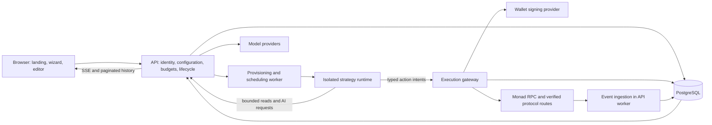

# Architecture

Status: implementation baseline, documentation only. Last reviewed: 2026-10-01.

## 1. Scope and assumptions

The product owns onboarding, hosted execution, curated integrations, model access, strategy tooling, metering, and wallet operation. Users configure behavior; they do not manage VPS accounts or supply cloud credentials. The latest brief explicitly requests **custodial** wallets. Provider key protection does not make our application non-custodial when our backend has signing authority.

“One click” is the final launch action after configuration, funding where applicable, and permission review. Free sandbox means both isolated execution and quota-limited simulated trading; it does not mean unlimited free model or server use. “AI guardrails” includes prompt/data handling and independently enforced monetary limits. “Morpheus” is an unresolved protocol name; it is not silently treated as Morpho.

MVP supports one chain, one verified swap route, API-hosted models, bounded JSON strategies, and one custodial wallet per agent. One user may later own several agents and wallets, all visible in one account. No shared omnibus trading wallet. Public custody, borrowing, leverage, arbitrary scripts, remote user-supplied MCP servers, multi-chain execution, and a native mobile app are outside the first release.

## 2. Chosen shape

A **modular monolith control plane with isolated execution processes**, not a fleet of independent business microservices. PostgreSQL is the source of truth for configuration, jobs, events, ledger entries, reservations, and reconciliation state. Each deployable has a security reason to exist.

The diagram shows logical traffic. The browser never reaches the runtime or signer. Runtime receives a short-lived capability scoped to one agent, deployment generation, and mode. It cannot access PostgreSQL, provider API keys, signing credentials, cloud metadata, or general internet destinations. API workers are a process role of `apps/api`, not a new repository/package for every worker.

| Module | Interface and responsibility | Authority |
| --- | --- | --- |
| Web | Draft, validate, estimate, deploy, pause, inspect | Authenticated user requests only |
| API | Tenant-scoped configuration and lifecycle; metered read/AI requests | Control DB writes, cloud launch role; no wallet signing credentials |
| Runtime | Execute immutable strategy against recorded observations | Narrow read/AI/intent capability; no direct money movement |
| Executor | Accept intent, authorize, reserve, build, simulate, sign, settle | Narrow ledger/transaction DB role; signing-provider credential |
| Contracts | Versioned schemas and error vocabulary | No network or secrets |
| Strategy | Compile/validate/evaluate, produce typed intents | Pure core with supplied observations; no signing |
| Connectors | Discover capabilities, ingest/read, build known actions | Separate read and executor entry points; never bypass policy |
| Accounting | Reserve, commit, release, reconcile amounts | Atomic database transactions shared by API and executor |
| Policy | Evaluate an immutable intent and current authorization context | Pure decision plus reason codes; executor enforces result |

These package seams have real consumers: strategy validation runs in the browser and API, interpretation in runtime; accounting is shared by model/hosting billing and transaction execution; connector read paths and transaction builders are intentionally separated.

## 3. Technology choices

| Area | Decision | Reason / constraint |
| --- | --- | --- |
| Workspace | pnpm workspace, TypeScript strict mode | Shared contracts and one language for a small team; no build orchestrator until measured need |
| Runtime | Node 24 LTS; lock exact compatible patches at G1 | LTS baseline, not a beta; [official release policy](https://nodejs.org/en/about/previous-releases) |
| Frontend | React + Vite, static hosting | Dashboard and wizard need no server-rendered framework in MVP; landing metadata/prerender can be added deliberately |
| Editor | Blockly with custom domain blocks | Existing block editor, keyboard alternatives; [JSON serialization recommended upstream](https://developers.google.com/blockly/guides/configure/web/serialization) |
| Backend | Fastify, native HTTP/fetch, explicit SQL using `pg` | Small module interfaces, schema validation, transactional control without ORM ambiguity |
| Schema | JSON Schema 2020-12 + Ajv; types generated from schemas | Same trust-boundary contract everywhere; [standard](https://json-schema.org/draft/2020-12) |
| Storage | Managed PostgreSQL 17 initially | Mature managed availability; queue and transactional records in one place; upgrade only after provider compatibility check |
| Chain | viem + verified Monad RPC; Privy server-wallet signing | Typed EVM interaction, vendor-managed key infrastructure; signer capabilities still require proof |
| Docs | VitePress static build, separate deployment | Reuses Markdown without coupling tutorials to the trading app |
| Hosting | AWS reference deployment; sponsor-funded Alibaba evaluation | Do not make unissued credits an architectural dependency |
| Model access | Explicit Kimi adapter first; Qwen adapter second | Actual capabilities and billing vary despite compatible HTTP shapes |

No dependency is installed by this scaffold. Exact versions, licenses, SDK compatibility, and provider API capabilities are verified at G1. Current service facts are evidence, while the table's stack selection is our design decision.

## 4. Configuration is data, never a program

The editor stores its workspace separately from the execution document. A compiler traverses allowed block types, performs type/unit checks, and emits a bounded JSON strategy. The API independently validates both the strategy and the deployment request. It resolves connector versions, model catalog entries, budget/policy versions, tenant ownership, and the selected mode into an immutable deployment manifest.

The manifest includes hashes of strategy/configuration, pinned connector versions, catalog/rate-card versions, runtime image digest, policy version, and secret **references**. It contains no API keys, wallet keys, executable JavaScript, shell commands, arbitrary URLs, or cloud instance specifications supplied by the user. Resources are selected from server-owned profiles. See [strategy language](docs/specs/strategy-language.md) and [API/data contracts](docs/specs/api-and-data.md).

Changing a draft never mutates a running deployment. Explicit redeploy creates a new revision and generation. The old generation loses permission to make new reservations, outstanding transactions are reconciled, and the replacement starts at a durable event cursor. Policy tightening and pause invalidate execution authorization immediately without waiting for a new strategy image.

## 5. End-to-end flows

### Onboarding and launch

1. Sign in; choose rookie or advanced. The rookie path starts in paper mode.
2. Select enabled connectors. Catalog entries disclose supported chain, reads/actions, live/paper status, required subscriptions, and limitations.
3. Select a preset or create typed blocks. AI nodes configure provider/model, supported reasoning setting, bounded prompt, input references, and an output schema.
4. Validate server-side. Show missing capabilities, cost ceilings, estimated runway, and an understandable strategy summary.
5. In paper mode, allocate virtual balances and platform-sponsored usage quota. In live mode, fund the agent deposit address, wait for finalized credit, and assign hosting/model/trading budgets.
6. Review the immutable version, independent spending limits, custody disclosure, and allowed actions. Launch writes deployment and provisioning job atomically; returns an operation ID.
7. Worker launches a pinned runtime image, checks health, activates the generation, and begins durable event delivery. Partial failure tears down charged resources or exposes a recoverable failed state; it never creates duplicate active generations.

### Observation to trade

1. Ingest a finalized chain log or timestamped provider observation into a normalized event with provenance; deduplicate it.
2. Serialize runs per agent; persist run identity, trigger state, and input snapshot.
3. Runtime interprets the strategy. Reads and AI calls cross the API's metered broker. AI returns schema-checked observations or choices, not authorization.
4. Runtime sends a typed intent referencing run, node, generation, mode, and observation hashes.
5. Executor verifies capability and fresh control state, re-reads balances/quotes, evaluates policy, atomically reserves funds and gas, assigns an exclusive nonce, builds allowlisted calldata, simulates, and asks the wallet provider to sign.
6. Persist signed-transaction identity before broadcasting when the signing provider supports it. For provider-managed send, use durable provider request identity and its documented recovery interface. Unsupported ambiguous-send recovery blocks live mode.
7. Reconcile canonical finalized receipts, settle actual amounts and fees, release unused reservations, and append audit events. An uncertain broadcast remains pending; it is never retried as a new trade automatically.

### Pause, withdraw, and exhaustion

Pause first revokes new action authority, then stops event consumption and compute. Already-broadcast transactions remain in reconciliation. Withdrawal is a user-authenticated executor operation with step-up verification, not a strategy block. Funding/withdrawal and reservations serialize against the same agent balances. Budget exhaustion pauses affected execution; trading funds are never silently reallocated to hosting or API costs.

### Self-hosted connectors

Publish the same curated connector capabilities as a library and MCP server after the hosted slice works. The operator supplies keys, runtime, policy, and custody. A hosted configuration can export only the strategy and sanitized capability requirements. Server secrets, customer data, hosted wallet authority, and sponsored quota never travel with the export.

## 6. Funds and billing

The **one-wallet experience is not three on-chain wallets or a guarantee that vendors accept crypto**. Each agent has a deposit/trading wallet and a per-asset double-entry ledger. Hosting and API allocations are reserved stablecoin liabilities until usage is earned. The platform pays AWS/Alibaba/model providers through its own vendor accounts. Earned charges can be transferred to a disclosed treasury destination with their own policy; no background conversion of trading principal.

Choose one verified stablecoin contract for live funding and a native MON gas reserve within the trading allocation. Do not presume a token symbol means a verified address or a dollar guarantee. Custody-provider signing controls complement, but do not implement, our three-bucket accounting. See [funds and budgets](docs/specs/funds-and-budgets.md) for journal examples, reservation lifecycle, unit conventions, quote expiry, withdrawals, and insolvency checks.

The recommendation estimates **operating runway subject to a user-selected minimum trading allocation**. It uses per-call/token maxima, event frequency, measured resource profiles, fixed hosting costs, and margin. It never allocates extra CPU just because a strategy has more blocks, or claims trading losses are predictable.

## 7. Durability and event ordering

PostgreSQL jobs use atomic claims with `FOR UPDATE SKIP LOCKED`, leases, attempt counts, and fencing generations. State changes and outbox entries commit together. Delivery is at least once. Intent identities, provider request IDs, transaction identities, and ledger posting keys make effects idempotent; there is no claim of global exactly-once execution. PostgreSQL documents `SKIP LOCKED` as suitable for queue consumers, not consistent general-purpose reads. [SELECT documentation](https://www.postgresql.org/docs/current/sql-select.html)

Use event timestamps for market meaning, receipt time for processing, and block number/hash/log index for chain identity. WebSocket notifications are hints; reconnects backfill from durable cursors. “Finalized” is checked against the RPC's actual finalized head and canonical block hash. A receipt alone is not sufficient on Monad. Do not substitute a sleep duration for finality. See [runtime specification](docs/specs/runtime.md) and [runtime research](docs/research/runtime-and-security.md).

## 8. Hosting and isolation

Local development uses separate processes/containers with paper execution. The reference hosted topology is an API/worker deployment, separate executor, managed Postgres, private object storage for redacted artifacts, and an isolated container task per active paid agent. Shared event subscriptions reduce RPC duplication. Free paper sessions use short-lived tasks with strict idle and lifetime quotas, rather than promising a permanently dedicated free VPS.

Prefer ECS Fargate for the first public hosted isolation boundary if eligible and affordable; it reduces host management. A small VM running containers is acceptable for trusted team-only paper demos, not a claim of hardened multi-tenant sandboxing. Alibaba can replace compute after the same isolation, metering, revocation, recovery, and billing acceptance checks. Cloud budgets alert; application quotas and teardown enforce our limits.

Runtime egress goes through the broker, with an allowlisted network path. Strip cloud credentials and metadata access, run without root/privileges, make the filesystem read-only except quota-limited scratch space, cap CPU/memory/processes/time, and disallow Docker socket/host mounts. Neither Fargate nor a container alone solves prompt injection or wallet safety. [Security specification](docs/specs/security.md)

## 9. Monitoring, reliability, and cost targets

Basic status, event history, error reasons, budget balance, stop/pause, and transaction links are required in the first slice. Rich charts, strategy comparisons, and mobile monitoring are later. Show brief decision summaries, selected inputs, policy verdicts, costs, and transaction outcomes; do not promise access to private model reasoning.

Initial acceptance targets are design targets, not measured claims: 10 simultaneous paper agents, one active run per agent, bounded 1,000-event backlog per agent, control API p95 under 500 ms excluding external providers, pause authority change within 2 seconds of accepted request, and recovery of claimed jobs within their lease bounds. Values and overload behavior live in [runtime](docs/specs/runtime.md). Provider/chain latency is measured separately.

Use structured JSON logs with trace/run/intent IDs, redaction, and metrics for queue age, reservation age, pending nonces, cost-estimate error, provider failure, budget exhaustion, and reconciliation mismatch. Database backup restore and signer revocation drills are live-release gates. Never trade to “catch up” after a long outage without freshness checks.

## 10. Alternatives and expansion triggers

| Rejected now | Why | Reconsider when |
| --- | --- | --- |
| Kubernetes, Kafka, Redis, workflow platform together | Operations exceed demonstrated needs | Queue lag, throughput, or recovery requirements exceed measured PostgreSQL design |
| One VPS per free user forever | Idle cost and abuse make free promise unbounded | A paid dedicated tier funds it |
| Arbitrary JS/Python strategies or shell agents | Enlarges sandbox and signing attack surface | Separate audited code-execution product is funded |
| AI decides and signs directly | Prompt outputs cannot enforce limits | Never; deterministic authorization remains |
| XML execution language | Legacy editor format and weaker fit to chosen stack | Existing user data requires an import adapter |
| Custom custody contracts / token / bridge | Adds money-critical code before product validation | A demonstrated requirement cannot be met by provider wallets and ledger |
| Multiple live DeFi protocols on day one | Every action family changes failure and risk semantics | First connector passes recovery and reconciliation checks |
| Native mobile app | Does not prove core workflow | Stable API and monitored agents justify a separate client |

The design settles module ownership and financial/execution semantics now. External facts—credits, exact deployed addresses, provider permissions, and launch-jurisdiction requirements—are explicit verification gates in [decisions](docs/decisions.md), not guesses hidden inside implementation.
