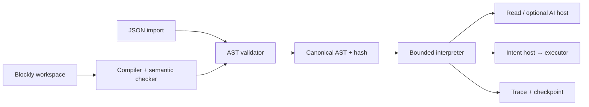

# Building the strategy language

2026-10-02. Implementation research, not implemented behavior. **The current `strategy/1` specification remains authoritative.** Recommendations below identify work and unresolved semantics; they do not approve new trading capabilities. Users supply strategies; AI never creates or rewrites them.

## 1. What we are building

A small, typed, event-driven domain-specific language (DSL). Its source is visual blocks; its executable representation is a JSON abstract syntax tree (AST). Each block has a defined meaning, compatible input/output types, an error policy and a cost bound. It is not a new general-purpose programming language or an LLM prompt.

There are three independent representations:

| Representation | Purpose | Authority |
| --- | --- | --- |
| Blockly workspace | Blocks, fields, connections, layout and comments | Editable source; untrusted on submission |
| Validated canonical AST | Ordered triggers/statements and typed expressions | Immutable authored behavior |
| Resolved deployment manifest | AST hash, runtime image, catalog/model/policy versions, mode | Pins executable environment; current revocation still overrides it |

Execution state is a fourth artifact, not part of the program: trigger baselines, run frames, recorded observations, pending intents and checkpoints. Editing a draft does not modify that state or a running deployment. See [language](../specs/strategy-language.md), [deployment](../specs/api-and-data.md) and [runtime](../specs/runtime.md).

**Recommendation:** implement a direct tree-walking interpreter first. The program is already small and bounded; bytecode, JIT, LLVM, WebAssembly and a custom textual parser add no demonstrated benefit. JSON still needs a strict, bounded import parser. Static resolution and type checking are separate passes, as illustrated by the original [Crafting Interpreters resolver chapter](https://craftinginterpreters.com/resolving-and-binding.html).

## 2. What the current language can express

| Family | Current capability | Important boundary |
| --- | --- | --- |
| Scheduled automation | Execute a bounded body at UTC intervals | Missed slots coalesce; no arbitrary sleep or finite-run counter |
| Price crossings | Fixed threshold above/below with freshness and cooldown | First sample initializes; staying above is not another crossing |
| Catalog events | Respond to known typed connector events | No arbitrary webhook/tool/event registration |
| Conditions | Compatible-type comparisons, AND/OR/NOT, if/else | Boolean only; no truthiness or missing-data fallback |
| Data | Allowlisted typed reads with provenance | Catalog must actually define and support the operation |
| Arithmetic | Same-unit add/subtract, scalar multiply/divide | No general price × quantity, monetary ratio or currency conversion |
| Trades | Exact-input swap of fixed atomic amount or fraction of available input-token inventory | No named-position sizing, computed amount expression, limit order or arbitrary recipient |
| Repetition | Literal bounded repeat within a run | Does not mean “buy daily ten times” |
| AI | Explicit authored allow/skip or summary node | Not strategy creation; bounded, recorded, independently authorized |
| Reporting | In-app notification and run completion | `stop` ends a run, not the agent; no withdrawal block |

Four specified presets are a good conformance corpus: observe/explain, scheduled purchase, threshold partial sale and AI-gated purchase. Their parameter forms must produce ordinary ASTs, not special preset execution paths. Spend caps belong to policy; “minimum position” requires an explicitly defined available-inventory read and condition. [Product presets](../specs/product.md).

The present language does not implement complete indicator/position strategies. Our [public-strategy audit](strategy-rehearsal-and-coverage.md) documents why. Keep unsupported controls unavailable rather than encoding an approximation without telling the user.

## 3. Reuse versus custom implementation

| Option | What it supplies | Fit here |
| --- | --- | --- |
| Blockly + our AST/interpreter | Visual editing plus domain semantics we own | Existing selected approach; strongest fit to exact units, durable effects and node traces |
| CEL expression engine | Parsed/checked expressions and side-effect-free evaluation | Potential later expression component; does not supply order execution, positions, checkpoints or our unit rules |
| JSON Logic | JSON rules and a ready evaluator | Its coercion, truthiness and generic access semantics differ from our closed typed contract; not a drop-in interpreter |
| JS/Python user programs | Broad expressiveness | Separate code-execution product, not current v1 |
| Temporal/workflow engine | Durable orchestration and replay machinery | Later operational alternative; does not replace our language/compiler or financial authorization |

CEL documents parse/check/evaluate separation and typed evaluation; its language includes numeric semantics that require checking against our exact-money rules. JSON Logic explicitly supports coerced equality, non-Boolean truthiness and dot-path data access. These are reasons to compare semantics, not reasons these tools are universally unsafe. [CEL overview](https://cel.dev/overview/cel-overview), [CEL definition](https://github.com/google/cel-spec/blob/v0.13.0/doc/langdef.md), [JSON Logic operations](https://jsonlogic.com/operations.html).

## 4. Contracts before compiler code

Implement closed tagged unions for triggers, statements and expressions in `packages/contracts`. Use JSON Schema 2020-12; generate TypeScript wire types from the schema and verify generation rather than maintaining two grammars. Runtime validation remains necessary because TypeScript does not validate imported JSON. A candidate generator is [json-schema-to-typescript](https://github.com/bcherny/json-schema-to-typescript); verify its handling of our recursive unions/2020-12 features with fixtures before adopting.

Configure the 2020-12 Ajv class explicitly; the default export uses draft-07, and different draft families cannot simply share the same instance. Use trusted bundled schemas and strict schema compilation. Validate every union branch's required fields and close executable objects; `uniqueItems` alone does not prove unique node IDs. [Ajv drafts](https://ajv.js.org/json-schema.html), [strict mode](https://ajv.js.org/strict-mode.html), [standard](https://json-schema.org/draft/2020-12).

**Recommendation:** executable validation should not coerce types, inject defaults or remove unknown fields. Defaults belong in the author's explicit construction step, followed by validation. Ajv documents that data-mutating options make validation impure and can make results depend on evaluation order. [Mutation behavior](https://ajv.js.org/guide/modifying-data.html).

Before expensive traversal: enforce byte, nesting, node, property and string limits. On raw JSON, detect duplicate object keys before ordinary parsing discards the evidence. For in-process inputs also reject cycles, accessors and non-JSON values; never walk arbitrary class instances supplied by callers. Resolve only bundled schema references, not network `$ref` targets. Use bounded simple patterns; avoid unlimited aggregate errors at public boundaries. Ajv treats schemas as trusted code and documents deep input, regex and validation resource risks. [Ajv security](https://ajv.js.org/security.html).

## 5. Compiler passes

| Pass | Output / responsibility |
| --- | --- |
| Source preflight | Supported workspace envelope/version; bounded block count/depth; no unknown executable block |
| Decode domain blocks | Read known fields, statement/next connections, shadow/default inputs and supported extra state |
| Build tree + source map | Ordered AST; stable AST-node/path → editor-block mapping |
| Resolve bindings | Earlier declarations only; branch/repeat scope; approved record fields; duplicate/unbound names fail |
| Check types and units | Exact operator signatures, asset/network/mode identity, observation extraction/freshness |
| Check capabilities | Required read/event/action/model operations against selected versioned catalogs |
| Analyze bounds | Worst-case steps, expression visits, AI calls, intents and bounded data sizes |
| Normalize + hash | Explicit decimal normalization; RFC-compliant canonical bytes; SHA-256 |

The server reruns the compiler/checker and compares the submitted preview hash. It must not trust a browser's typed AST, catalog selections or cost report. AST-only imports use the same semantic checker. The strategy package's compiler adapter should consume a bounded source representation without importing DOM/rendering or signer code into the server/browser core.

For sequential statements, upper-bound costs add; an `if` adds condition cost plus component-wise maximum branch cost; a literal repeat multiplies its body cost and accounts for loop overhead. Include expressions and host calls in the step definition. Do not sum mutually exclusive branches as if both trade, or assume an observed cheap branch proves a safe worst case. Host quotas remain authoritative at runtime.

Avoid aggressive optimizations initially: reordering short-circuit expressions can change which error is observed; folding reads/AI would change effects. Static bounds prove bounded interpreter work, not profitable trades or external-call completion.

## 6. Blockly integration details

Build domain trigger, statement and value blocks. Toolbox choices come from supported capabilities; disconnected enabled executable blocks and missing sockets block deployment. Disabled blocks remain editor metadata. Define inherited-disabled and disabled-parent behavior explicitly, including whether a disabled required value is an error.

Blockly connection checks are compatible string labels, not a domain type checker. Use them for immediate guidance, then enforce assets, units and scope in our semantic checker. Monetary inputs should preserve decimal text; do not pass them through a numeric field's floating-point value and convert back. Validate on save/import, not only when a field changes. [Custom blocks](https://docs.blockly.com/guides/create-custom-blocks/overview/), [connection checks](https://docs.blockly.com/guides/create-custom-blocks/inputs/connection-checks/), [field validators](https://docs.blockly.com/guides/create-custom-blocks/fields/validators/).

Two concrete source-format issues need resolution:

- **Identity:** Blockly-generated IDs can contain punctuation excluded by our AST ID grammar. Persist a separate legal AST-node ID mapping, or generate deliberately compatible IDs; do not sanitize with a collision-prone replace operation or mint new IDs on each compile. Copy/paste must create new logical node IDs. [Maintainer ID generator source](https://github.com/google/blockly/blob/master/core/utils/idgenerator.ts).
- **Order:** Blockly documents arbitrary top-level block deserialization order. Our trigger declaration order affects behavior. Preserve it in explicit executable source metadata or an ordered root structure; do not derive it from x/y coordinates or object iteration. Moving blocks must not change the program. [Serialization](https://developers.google.com/blockly/guides/configure/web/serialization).

Dynamic shapes, additional branches and optional inputs need round-trip-tested `extraState`/mutators. Blockly variable fields store IDs rather than displayed names; its variable menu alone does not enforce our lexical scopes. Use scope-aware references and a shared resolver. Register only reviewed block definitions/serializers on the server. [Mutators](https://docs.blockly.com/guides/create-custom-blocks/mutators/), [variables](https://docs.blockly.com/guides/create-custom-blocks/fields/built-in-fields/variable/).

AST import should generate an editable layout while preserving behavior and node identity. Unknown future blocks may be displayed read-only, but never executed. Keyboard-accessible tree/forms editing, undo/redo, autosave and errors focused on the actual block are product requirements; guided rule cards remain unapproved. Tests should cover editing, not only screenshots.

## 7. Exact arithmetic and canonicalization

Use token atomic units as validated strings on the wire and bounded `bigint` internally. Decode only after length/range validation. Explicit asset identity and decimals come from a pinned catalog, never a token symbol or an AI response. Decimal operations need a specified scale, precision, rounding and overflow rule; `bigint` is an integer primitive, not a decimal implementation. If a maintained decimal library is selected, pin its configuration and make both browser/server behavior identical. [BigInt reference](https://developer.mozilla.org/en-US/docs/Web/JavaScript/Reference/Global_Objects/BigInt).

Golden example: 2 ETH inventory with 0.2 ETH reserved gives 1.8 ETH available. A 1,000-bps sale spends 0.18 ETH, not 0.2 ETH: 180,000,000,000,000,000 atomic units at eighteen decimals. For a hypothetical six-decimal token, 0.18 units is 180,000 atomic units. Authorization resolves and freezes the amount once; replay does not recompute it from a changed balance.

Specify spending-floor versus reserve-ceiling rounding, zero dust, negative intermediate results, precision after multiplication/division, large intermediates and divide-by-zero. Native gas reserves and other pending holds reduce availability. Comparing WETH money with stablecoin money, or USD/WETH price with USD/MON price, is a type error.

JCS canonicalizes JSON encoding/property ordering, not semantic equality. It preserves string content and does not normalize decimal strings or Unicode for us. Adopt one documented decimal-string form before hashing. A string `"1.0"` is otherwise different from `"1"`. A full AST hash includes its IDs/name; it is not proof that differently named programs are behaviorally equivalent. Hashes prove integrity, not authorization. [RFC 8785](https://www.rfc-editor.org/rfc/rfc8785.html).

## 8. Interpreter and host boundary

The interpreter receives a validated program, pinned catalogs, recorded run context and a supplied host. It evaluates expressions with no network, wall clock or randomness. Statements advance an explicit continuation stack with branch, sequence and repeat frames; checkpoint it as bounded data, not a JavaScript closure or unresolved Promise.

Conceptual interfaces, to formalize in contracts:

| Interface | Responsibility |
| --- | --- |
| `compileWorkspace` / `validateAst` | AST, hash, source map, diagnostics, bounds/capability report |
| `evaluateExpression` | Typed value or error from explicit immutable bindings |
| `advanceRun` | Advance bounded steps; return checkpoint, completed/failed/waiting state and host command |
| Observation host | Validate operation/input, record provenance/freshness and metering |
| AI host | Reserve/dispatch bounded call; supply recorded validated result on replay |
| Intent host | Submit durable typed intent; executor resolves/policies/authorizes actual effect |
| Trace/checkpoint host | Persist node/path results and continuation before acknowledging progress |

These names are proposals, not existing exported functions. Pure core belongs in `packages/strategy`; transport, database and process lifecycle belong in apps/host adapters. Strategy never imports accounting DB code, cloud APIs, RPC signing or provider secrets.

Every financial statement suspends until its effect has a definitive disposition. Pending/unknown does not mean failed. A failed later node cannot undo an earlier settled trade. Decide explicitly whether a definitive rejection ends the run; safest v1 proposal is abort, since no recovery/catch block exists. `notify` must not claim success before settlement.

Replay uses the same ordered commands and recorded external outcomes. Do not reread current markets, call the model again or mint new trade IDs while reconstructing completed work. Temporal's documented replay/versioning model provides useful precedent; it is not evidence that our custom engine already has those guarantees, and adopting Temporal is not proposed here. [Replay](https://docs.temporal.io/encyclopedia/event-history/event-history-typescript), [versioning](https://docs.temporal.io/develop/typescript/versioning).

## 9. Event/time semantics

Keep source event time, receipt time and evaluation time distinct. UTC schedules require defined anchors, freshness and missed-slot handling. Duplicate source keys must not create new runs. One agent's triggers/runs are serialized even when events arrive concurrently.

Use the existing precise crossing rules: previous ≤ threshold/current > for upward crossings, inverse for downward. First fresh sample establishes baseline; equality does not fire. Out-of-order observations cannot move state backward. Stale/coalesced gaps reset the baseline. Cooldown starts on run acceptance even if the subsequent trade fails; suppressed crossings are not delayed trades.

Define permitted clock skew/future-dated observations, equal-time source ordering, cooldown time basis and the boundary exactly at expiry. Control-plane ingestion owns provenance/deduplication; the language core owns the trigger transition function. Pause/redeploy/generation changes belong to runtime authorization and must be exercised against trigger recovery.

## 10. What indicator/position expansion would require

This is **research for a later scoped language revision**, not current v1 approval:

| Capability | Semantics needed before adding a block |
| --- | --- |
| Candles | Venue/pair/timeframe identity, finalized close time, gaps, incomplete-bar policy and history bounds |
| RSI/EMA/Bollinger/etc. | Formula/version, input series, initialization/warm-up, output precision, insufficient-history errors and bounded cost |
| Series crossings | Previous/current values for both series, aligned timestamps, accepted-candle identity |
| Positions | Strategy-owned position identity, settled-fill-derived quantity/cost/age, fees, partial exits and averaging rules |
| Stop loss / take profit / trailing | Entry-relative versus peak-relative basis, activation, simultaneous signals, gap/slippage behavior and revision migration |
| Rebalancing / dynamic sizing | Unit-safe valuation/ratios, computed amount grammar, rounding and executor policy enforcement |
| Finite DCA / once-only actions | Typed durable counters/state transitions, event identity and reset rules |
| Resting orders / grid | Place/cancel/fill/expiry state, cancellation races, multiple active levels and expanded reservations |

Do not add generic mutable variables just to disguise missing position semantics. Persistent state needs bounded schema, namespace, initialization, concurrency and migration rules. Trigger state already exists but is not an arbitrary user-accessible store.

Freqtrade documents candle ordering, indicator startup history and lookahead/recursive-analysis concerns. Its examples demonstrate why a period-100 EMA is not merely “read the last 100 values” with universally identical initialization. Historical evaluation must restrict each node to data available at that time. Candle OHLC alone cannot establish whether a stop or target was reached first inside a bar; disclose an ordering/fill assumption or require finer data. [Strategy customization](https://docs.freqtrade.io/en/stable/strategy-customization/), [lookahead analysis](https://docs.freqtrade.io/en/stable/lookahead-analysis/), [recursive analysis](https://docs.freqtrade.io/en/stable/recursive-analysis/), [backtesting](https://docs.freqtrade.io/en/stable/backtesting/).

We are not evaluating investment performance or selecting strategies. Coverage must be measured against complete target-user entry/exit/sizing rules, not the number of block types.

## 11. Gaps to close before implementation fixtures

These are findings against the current prose, not changes silently made to it:

| Gap | Proposed resolution / next evidence |
| --- | --- |
| Editor IDs versus legal AST IDs | Persist stable legal ID mapping and copy/import rules |
| Order independent of canvas/load order | Explicit ordered trigger source structure |
| Binding names, duplicates and shadowing | Specify identifier grammar; reject duplicates in same scope; choose/document shadowing policy |
| Observation access | Define exact catalog records, extraction, stale/missing propagation and allowed fields |
| Numeric operator signatures | Full per-type matrix; scale/rounding, literal canonical form, enum/Boolean/timestamp comparison rules |
| Fraction and duration boundaries | Explicit bps range, zero behavior, cooldown/age/interval maxima and clock-skew policy |
| Statement rejection/failure | Abort on definite failure by default; no implicit successful fall-through |
| Disabled/shadow/mutated blocks | Specify compilation behavior and source preflight schema |
| Step accounting | Count expressions, loop overhead and host dispatch; define active-time accounting |
| Hash terminology | Document full-document integrity hash; distinguish layout, revision and semantic equivalence |
| Preset contracts | Define synthetic read/catalog fixtures and policy caps so all four are actually expressible |
| Continuation/trace schemas | Version bounded frames/results/source maps; define persisted versus derived data |
| Compiler/engine updates | Pin execution semantics in image/version; preserve old runs and explicitly migrate drafts/state |

A validated shape can still contain an undefined meaning. Close these with approved normative fixtures before implementing that behavior. This does not require cloud accounts or a live wallet.

## 12. Testing that makes the language trustworthy

| Test family | Evidence required |
| --- | --- |
| Schema/import | Unknown versions/fields, duplicate keys/IDs, malformed decimals, huge/deep/cyclic inputs fail before effects |
| Type/scope | Wrong assets/units, unbound/forward references, inaccessible branch/repeat bindings and invalid record fields fail |
| Arithmetic | Token-decimal vectors, dust, floor/ceiling, overflow, negatives and divide-by-zero |
| Editor round trip | Save/load/AST import preserve intended AST hash; layout changes preserve it; behavior edits change it |
| Identity/order | Copy produces new IDs; reload preserves IDs/order; multiple triggers do not depend on canvas position |
| Trigger transitions | Equality, first sample, stale gaps, out-of-order/duplicate samples, cooldown failure/expiry and coalescing |
| Bound analysis | Runtime visits/calls/intents never exceed the reported static upper bound |
| Host sequencing | False branch has no effects; pending swap suspends later nodes; errors do not announce a successful sale |
| Recovery | Crash before/after each host boundary/checkpoint resumes the same run/effect identity |
| Authorization integration | Forged node/branch/generation/mode cannot widen approved intent or signing authority |
| AI | Invalid/schema-failed/timed-out/refused outputs stop; replay uses recorded result; no hidden retry/fallback |
| Evolution | Old artifacts/checkpoints remain replayable or are explicitly refused; migration does not silently redeploy |

Use hand-reviewed golden traces plus generated properties, not snapshots alone. Node's existing test runner is sufficient for initial pure tests. `fast-check` is a candidate for generated ASTs, malformed imports and trigger/checkpoint command sequences; its maintainers emphasize a simplified independent model rather than copying the implementation. Store failing seeds and minimized examples. Add only the dependency needed for demonstrated coverage. [Model-based testing](https://fast-check.dev/docs/advanced/model-based-testing/).

Browser tests cover critical keyboard/edit/import/error paths; integration tests cover executor and crash boundaries. No compiler/interpreter test suite was run during this research, since none exists.

## 13. Build sequence and ownership

| Step | Owning area | Deliverable / exit |
| --- | --- | --- |
| 1. Close prose gaps | Specs + contract owner | Operator/type matrix, source/continuation contract, reviewed synthetic fixtures |
| 2. Executable contracts | `packages/contracts` (G1) | Closed schemas, generated types, valid/invalid imports, pinned catalog fixtures |
| 3. Pure core | `packages/strategy` (G2) | Exact arithmetic, scope/types/bounds, canonical hash, explicit trigger transitions |
| 4. Interpreter | `packages/strategy` (G2) | One threshold sale and schedule fixture using a synthetic host; trace + resume data |
| 5. Blockly adapter | Strategy owner + handed-off `apps/web` scope | Custom blocks, compiler/source map, import/export and browser/server parity |
| 6. Four presets | Strategy + product/guide owners | All compile through the same core; demonstrated errors and limits |
| 7. Durable runtime | API/runtime/executor owners (G3–G6) | Persistence, broker/intent adapters, idempotency, policy and recovery proofs |

Do not start with AWS or a wallet. First prove a local synthetic event sequence can compile, evaluate, suspend, resume and produce one bounded intent. A synthetic host can test the language; it cannot prove live signing or settlement. Follow [package ownership](../../packages/strategy/AGENTS.md), [design policy](../../design.md) and existing gate dependencies. No implementation gates are closed by this document.

## 14. Research coverage and limits

Exa: 10 searches across editor/compiler, contracts/numerics, alternatives, trading semantics and replay/testing; 50 result entries screened, 49 distinct literal URLs. Follow-up fetches attempted 27 distinct URLs, with bounded extracts successfully returned for 26; two pages were fetched again with larger bounds. Blockly's ID API URL was unavailable, so the maintainer source was read instead. Search variants/redirects are not independent corroboration. Official/maintainer material was preferred; third-party search hits were excluded from conclusions.

The synthesis distinguishes upstream facts, existing project decisions, recommended hardening and unapproved expansion. Documentation does not prove dependency interoperability, byte-for-byte canonicalization, editor round trips, runtime throughput or trading coverage. Those require the fixture/probe work above. Source pages may be longer than the bounded extracts; this is a broad implementation audit, not a claim to exhaust all language-design literature. Package versions/licenses and compiler/browser compatibility must be rechecked when dependencies are adopted.
