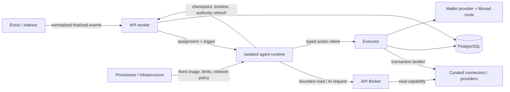

# Agent runtime implementation specification

Version: `agent-runtime/1` design baseline. Owner: `apps/runtime`, with strategy, API, executor, infrastructure and security-owner review. Status: normative design; no runtime behavior is implemented merely because this document exists.

This document specifies the hosted process that runs one deployed strategy safely. It explains the component in implementation terms, defines its boundaries and internal protocols, and gives the runtime owner a build and verification plan. The broader [runtime specification](runtime.md) remains authoritative for platform lifecycle, jobs, generations and recovery; [strategy language](strategy-language.md) for interpreter semantics and checkpoint shape; [executor](executor.md) for action admission and financial effects; [API/data](api-and-data.md) for shared transport/storage conventions; and [security](security.md) for platform-wide controls. Resolve conflicts before implementation rather than choosing the least restrictive rule.

## 1. What the runtime is

The runtime is a small, isolated host around the deterministic interpreter in `packages/strategy`. It takes an immutable deployment plus a recorded trigger, advances the strategy until the interpreter asks the outside world to do one thing, persists a checkpoint, dispatches that request through an approved internal service, records the result by reference, and resumes.

It is the place where a deployed strategy is *driven*, but it is not where the strategy language is defined and it is not allowed to authorize money movement.

In plain language:

- `packages/strategy` is the pure engine: given strategy state and a recorded result, it deterministically says what comes next.
- `apps/runtime` is the engine host: it authenticates, loads immutable inputs, saves progress, calls approved services, observes limits and survives restarts.
- The API/control plane owns users, deployments, jobs, durable state, event delivery and provisioning.
- The API Broker performs approved data/model calls using provider credentials, validates results and meters usage.
- The executor independently authorizes and performs paper or live financial effects.
- Connectors describe reviewed capabilities. Their read side is invoked behind the broker; their transaction-building side is invoked inside the executor. Connector code and credentials are not loaded into the runtime.
- Envio or another indexer feeds normalized events into API ingestion. It does not call runtimes directly and runtimes do not subscribe to Envio directly.
- PostgreSQL is authoritative, but only API/executor services connect to it. The runtime persists and retrieves state through authenticated internal APIs.

The runtime is not a general AI-agent shell, arbitrary JavaScript/Python sandbox, MCP client, connector host, database worker, wallet, signer or cloud scheduler. AI is one typed host command whose output must match a declared schema. Neither model text nor connector data can introduce code or new authority.

### Component connections



| Connection | What crosses it | What must not cross it |
| --- | --- | --- |
| API worker → runtime | Assignment reference, immutable manifest/AST reference, recorded run context, short-lived capability | Database credentials, cloud launch role, provider keys, wallet keys |
| Runtime → control API | Checkpoints, command/result references, run/timeline status, heartbeat and capability refresh | SQL, arbitrary tenant IDs treated as authority, raw secrets |
| Runtime → API Broker | Versioned read or AI command, logical command key, bounded typed inputs | Provider credential, arbitrary URL/model/tool, unbounded prompt or output |
| Runtime → executor | Closed `ActionIntent` proposal and its canonical logical key | Wallet/chain/recipient/nonce/calldata/signing choice |
| API ingestion → runtime | A durable run assignment derived from an accepted event | Direct webhook or indexer connection, provisional financial event in v1 |
| Infrastructure → runtime | Pinned image, resource profile, workload identity and network policy | Privileged container, host mount, Docker socket or general cloud role |

The ordinary flow is:

1. API ingestion accepts and deduplicates a trigger, then creates the run/job transactionally.
2. The provisioning worker launches or reuses the runtime for that agent and supplies an assignment reference.
3. The runtime verifies the assignment, deployment generation, manifest hash and interpreter compatibility.
4. It calls the shared interpreter. The interpreter either completes, fails deterministically or returns one `HostCommand`.
5. Before dispatching that command, the runtime asks the API to durably save the waiting checkpoint and command identity.
6. The runtime sends the command to the broker, executor or control API as appropriate.
7. A definitive or pending result is recorded. When resumable, the runtime reloads the accepted result reference and advances the same run.
8. Pause/revocation prevents new dispatch even if the isolated process has not terminated yet.

## 2. Responsibilities and non-goals

### Runtime responsibilities

- Verify the immutable deployment/run assignment before executing it.
- Run only the reviewed interpreter exported by `packages/strategy`.
- Enforce active-time, step, payload, concurrency and memory/process limits in addition to interpreter limits.
- Persist a waiting checkpoint before dispatching every host command.
- Translate interpreter `HostCommand` values into closed internal API requests.
- Reuse stable run, node, iteration and command identities on replay.
- Treat observations, model output and connector output as untrusted typed data.
- Refresh short-lived capabilities and stop dispatching when authority is lost.
- Recover safely from duplicate assignments, process death, timeouts and stale leases.
- Emit redacted structured telemetry sufficient to debug a run without logging secrets or unrestricted prompt content.
- Exit or become idle without losing authoritative state.

### Non-goals for `agent-runtime/1`

- Executing user code, generated code, shell commands, packages, uploaded images or downloaded skills.
- Holding PostgreSQL, model-provider, RPC, wallet-provider, connector or cloud credentials.
- Calling arbitrary internet destinations or accepting public inbound traffic.
- Implementing strategy semantics separately from `packages/strategy`.
- Authorizing a financial action or trusting an AI answer as authorization.
- Building calldata, choosing a route, reserving funds, assigning nonce, signing or reconciling a transaction.
- Running an executor as MCP or loading arbitrary MCP servers.
- Owning event indexing, durable schedules, job claiming, billing journals or cloud provisioning.

## 3. Trust model and invariants

The runtime is considered compromiseable. Safety must still hold if a malformed strategy input, prompt injection, bad provider result or runtime bug tries to exceed its authority.

The following invariants are mandatory:

1. A runtime has authority for exactly one tenant, agent, deployment generation and mode at a time.
2. One agent has at most one active run. Duplicate delivery may create repeated process work but not a second logical run or effect.
3. Runtime request bodies are claims, not identity. Gateways derive identity from workload authentication, capability claims and server state.
4. No host command is externally dispatched before its waiting checkpoint and logical command identity are durable.
5. A replay of the same `(deployment, generation, run, node, iterationPath)` returns or continues the same logical result.
6. No runtime filesystem content is authoritative. Process loss may cost compute, never accepted state or financial identity.
7. An expired/revoked/stale capability prevents new work. A signed/broadcast effect remains the executor's reconciliation responsibility.
8. Paper and live modes have separate authoritative identities and adapters. The runtime cannot switch a run's mode.
9. A connector, model or event may provide data only. It cannot enable a capability, raise a limit, change a recipient or cause code execution.
10. Unknown external outcomes are pending/reconciling, not automatically retried as fresh calls or trades.

## 4. Process model and lifecycle

The recommended v1 topology is one isolated runtime task per active paid agent, with strict short-lived tasks for free paper sessions. A task may stay warm across sequential runs, but processes are disposable and never hold the only copy of progress. Agents with a price trigger keep a warm task while running; cold-start tasks are acceptable only for schedule-only agents and free paper sessions, with their trigger latency labelled ([D33](../decisions.md)). Exactly one run is advanced at a time.

Runtime process states:

```text
starting -> verifying -> ready -> executing -> waiting -> executing
                                      |          |
                                      +-> idle <-+

starting/verifying/ready/executing/waiting/idle -> draining -> stopped
starting/verifying/executing/waiting -> failed
```

- `starting`: initialize the fixed application and local limit enforcement.
- `verifying`: fetch and validate the assignment and immutable artifacts.
- `ready`: health checks pass and the runtime can accept one assignment.
- `executing`: interpreter code is consuming active execution budget.
- `waiting`: a command is durably pending; no active execution time accrues.
- `idle`: no accepted run is assigned; the platform may reuse or terminate the task.
- `draining`: no new run or command dispatch; finish only safe local work and publish last status.
- `stopped` / `failed`: terminal process states, not necessarily terminal run states.

Long waits do not require a permanently running container. After persisting a pending executor/model/read reference, the runtime may idle or exit. The API worker later schedules a resume assignment with the same run and checkpoint. Do not busy-poll while waiting for transaction finality or provider recovery.

## 5. Runtime assignment contract

`packages/contracts` must define a closed `runtime-assignment/1` schema before implementation. The assignment is created by the API worker and either injected at launch or fetched using a single-use bootstrap reference. The bootstrap value is secret and must not appear in arguments, logs or downloadable configuration.

Normative example (the `paper-price-crossing` fixture of [`runtime-assignment-1`](../../packages/contracts/schemas/runtime-assignment-1.schema.json)):

```json
{
  "schemaVersion": "runtime-assignment/1",
  "assignmentId": "019a0000-0000-7000-8000-000000000201",
  "lease": {
    "owner": "runtime-local-1",
    "fencingToken": "17",
    "expiresAt": "2026-10-07T12:00:30.000Z"
  },
  "deployment": {
    "deploymentId": "019a0000-0000-7000-8000-000000000202",
    "generation": "3",
    "mode": "paper",
    "manifestHash": "0xaaaaaaaaaaaaaaaaaaaaaaaaaaaaaaaaaaaaaaaaaaaaaaaaaaaaaaaaaaaaaaaa",
    "runtimeImageDigest": "0xbbbbbbbbbbbbbbbbbbbbbbbbbbbbbbbbbbbbbbbbbbbbbbbbbbbbbbbbbbbbbbbb",
    "connectorVersions": {
      "paper.uniswap": "1.0.0",
      "paper.kuru": "1.0.0"
    }
  },
  "interpreter": {
    "languageVersion": "strategy/1",
    "checkpointVersion": "strategy-run/2"
  },
  "run": {
    "runId": "0x2222222222222222222222222222222222222222222222222222222222222222",
    "deploymentRevision": "019a0000-0000-7000-8000-000000000202/3",
    "triggerId": "crossing",
    "sourceEventKey": "chain:10143:0xcccccccccccccccccccccccccccccccccccccccccccccccccccccccccccccccc:4"
  },
  "trigger": {
    "observationRef": "019a0000-0000-7000-8000-000000000111",
    "observedAt": "2026-10-07T11:59:59.400Z",
    "acceptedAt": "2026-10-07T11:59:59.900Z",
    "runCreatedAt": "2026-10-07T11:59:59.900Z"
  },
  "artifacts": {
    "strategyRef": "artifact:deployment/019a0000-0000-7000-8000-000000000202/strategy",
    "strategyHash": "0xdddddddddddddddddddddddddddddddddddddddddddddddddddddddddddddddd",
    "catalogRef": "artifact:catalog/paper/1",
    "catalogHash": "0xeeeeeeeeeeeeeeeeeeeeeeeeeeeeeeeeeeeeeeeeeeeeeeeeeeeeeeeeeeeeeeee"
  },
  "capabilityRef": "capability:assignment/019a0000-0000-7000-8000-000000000201",
  "issuedAt": "2026-10-07T12:00:00.000Z",
  "expiresAt": "2026-10-07T12:01:00.000Z"
}
```

Implemented 2026-10-07 as `runtime-assignment/1` in `packages/contracts`, with these resolved choices: `run.triggerId` is the strategy's own trigger ID (for example `crossing`), not a UUID; hashes and digests use the repository's lower-case `0x` SHA-256 form; `run.deploymentRevision` is an opaque string chosen by the control API (the local stand-in uses `<deploymentId>/<generation>`) and is the interpreter's run-identity input, so `runId` equals `SHA-256(JSON.stringify([deploymentRevision, triggerId, sourceEventKey]))`; `deployment.connectorVersions` carries the manifest's pinned connector versions copied into each `ActionIntent`; `trigger` records the trigger observation and stage times for latency measurement ([D34](../decisions.md)); `artifacts.strategyHash` is `compileStrategy(...).hash` and `artifacts.catalogHash` is `contentHash(catalog)`. The assignment carries no checkpoint reference: the runtime always loads the authoritative run state (`run-state/1`). The schema contains references, not provider credentials. The runtime rejects an unknown schema version, expired assignment, mismatched image digest, unsupported strategy/checkpoint version, invalid hash, wrong mode, stale generation or fencing conflict.

The immutable manifest supplies pinned connector/model/catalog/policy versions, allowed reads/actions, resource profile and strategy hash. It must never contain user programs, arbitrary URLs, raw keys or cloud specifications. Canonical hashing uses the repository's JCS/SHA-256 utilities rather than ad hoc JSON stringification.

## 6. Capability and authentication

The runtime uses two layers:

- Workload identity proves the request came from an approved runtime workload.
- A short-lived capability restricts what that workload may do for the current assignment.

Minimum capability claims are audience, tenant, agent, deployment ID, generation, mode, allowed connector/read/action IDs, optional run ID, issue/expiry time and unique token ID. Maximum lifetime is five minutes. A token refresh checks current desired state and generation and may narrow, never widen, the immutable manifest.

Use audience-specific capabilities for the control API, broker and executor, or an exchange endpoint that mints them from the assignment capability. A token accepted by one service must not automatically be usable at another. Token text and bootstrap references are redacted from logs, traces, crash dumps and errors.

The runtime requests refresh before expiry with bounded jitter. Refresh denial immediately enters `draining`; it does not repeatedly retry with the old token. Gateways still check current revocation for sensitive dispatch, so five-minute expiry is not the pause latency.

## 7. Internal service contracts

Routes below are the proposed `agent-runtime/1` interface. They become implementation authority only after their closed schemas are added to `packages/contracts` and reviewed by the owning service. All routes use internal HTTPS, workload identity, scoped capability, request IDs, body limits and closed JSON validation.

### Control API

| Operation | Purpose | Required behavior |
| --- | --- | --- |
| `GET /internal/v1/runtime/assignments/{assignmentId}` | Redeem bootstrap and load assignment | Single-use or safely replayable for same workload; never return broader credentials |
| `POST /internal/v1/runtime/assignments:poll` | Warm task long-polls for its next assignment (`assignment-poll/1` → `assignment-offer/2` with the assignment's bearer capability, [D33](../decisions.md)) | Workload-authenticated; at most one assignment per lease; `drain` tells the process to stop taking work |
| `GET /internal/v1/runs/{runId}` | Load the accepted checkpoint, the recorded result of its waiting operation and the run's observation refs (`run-state/1`) | Fenced by assignment and token; a brand-new run has no checkpoint |
| `GET /internal/v1/runtime/artifacts/{artifactRef}` | Fetch immutable manifest/strategy/checkpoint | Verify caller scope; return content hash and version |
| `POST /internal/v1/runs/{runId}/wait` | Persist checkpoint and pending command before dispatch (`run-wait/1`) | Transactionally deduplicate logical command and compare lease/fencing token |
| `POST /internal/v1/runs/{runId}/results` | Record a definitive or pending host result reference (`run-result/1`) | Idempotent by command key; conflicting result is rejected |
| `POST /internal/v1/runs/{runId}/complete` | Commit completed/failed interpreter outcome (`run-complete/1`) | Conditional on current checkpoint/fencing token |
| `POST /internal/v1/runs/{runId}/timeline` | Append a bounded user-safe runtime event (`timeline-entry/1`) | Idempotent and redacted; not an authority or result store |
| `POST /internal/v1/runtime/heartbeat` | Renew assignment lease and report health (`runtime-heartbeat/1` → `runtime-lease/1`; also extends the capability) | Reject stale fencing token; cannot revive a revoked generation |
| `POST /internal/v1/runtime/capabilities:exchange` | Exchange the control capability for an audience-scoped one (`audience-capability/1`; executor or broker, D38) | Current lease of an active generation only; scoped to the run; never longer than the control capability. The control capability itself is extended by the heartbeat |

Implemented 2026-10-08 in `apps/api/src/runtime-control/` (migration 0003); see the [control API guide](../integration/control-api.md). The API performs the database transaction. The runtime never simulates atomicity by making unrelated HTTP writes and assuming they committed together.

### API Broker

The broker accepts versioned `read` and `ai.decide` requests. Each carries the interpreter command identity, manifest-approved catalog reference, bounded typed inputs and declared output schema where applicable. It derives tenant/deployment/run from authentication, reserves/meters usage, invokes approved providers, validates the result and records provenance.

The broker returns one of:

- `completed` with an immutable result reference and safe typed value;
- `pending` with a durable operation reference and resume hint;
- `refused` with a stable reason code and no provider dispatch;
- `unknown` when a dispatched billable provider call may exist and requires reconciliation.

The runtime must not automatically submit a fresh model call after an ambiguous timeout. Reads may use bounded retries only under the retry rules in [runtime](runtime.md), with the same logical command identity and freshness deadline.

Persisted answers (`persisted-broker-result/1`) are read by ID through the broker store with tenant/deployment/generation/run scope. Migration 0006 stores immutable answers with operation, node, typed value, timestamps and bounded provenance. A durable operation claim precedes provider dispatch. Concurrent/restarted identical requests return the stored answer without dispatch; conflicting input returns `IDEMPOTENCY_CONFLICT`. Reconciliation appends an answer and updates only the operation pointer. The paper broker route `POST /internal/v1/broker/requests` accepts only broker-audience capabilities issued by the control exchange. Admission checks the current assignment lease, generation and waiting command. Reads use fresh recorded observations; `paper.kimi` remains an explicitly synthetic profile. Terminal reconciliation is consumed by the control worker so restart does not lose resume work. Real provider adapters and metering remain #8/#9.

### Executor

For `swap.exactInput`, the runtime maps the interpreter command to `ActionIntent` and calls `POST /internal/v1/intents` exactly as specified in [executor](executor.md). It computes:

```text
SHA-256(JCS({
  schemaVersion: "intent-key/1",
  deploymentId,
  generation,
  runId,
  nodeId,
  iterationPath
}))
```

The runtime sends no tenant, wallet, chain, route, recipient, spender, nonce, gas, deadline, calldata or signer field. `200`, `201` and `202` are valid disposition responses; timeout is not permission to create a new logical intent. Pending intents release active execution and resume from the same checkpoint when the API schedules the result.

### Connector boundary

A `connectorRef` is a pinned catalog capability identifier, not a network address or executable plugin. The runtime may carry that identifier because the strategy node refers to it. It does not import the connector implementation or invoke its MCP server.

- Read connectors run behind the API Broker.
- Transaction quote/build/decode connectors run inside the executor boundary.
- Envio/indexer adapters run in API event ingestion.
- A later self-hosted connector distribution may expose MCP, but that is outside the hosted runtime protocol.

## 8. Driving the interpreter

`packages/strategy` remains the only implementation of language semantics. `apps/runtime` supplies a thin adapter around its public `startRun`/resume/advance interface. If the current exported names differ, preserve the behavior rather than duplicating the interpreter.

The engine advances at most one external command at a time. The host loop is logically:

```text
load and verify assignment, strategy and accepted checkpoint
while authority and active budget remain:
  outcome = advance interpreter from accepted checkpoint/result
  if outcome is complete or deterministic failure:
    conditionally persist terminal state
    stop run
  if outcome is HostCommand:
    derive stable command identity
    persist waiting checkpoint + command identity through API
    recheck local expiry/drain state
    dispatch command to the approved service
    record returned result/reference through API
    if pending or unknown: release active slot and wait for resume assignment
    else resume using the accepted recorded result
```

Current supported commands are `read`, `ai.decide`, `swap.exactInput` and `notify`. Unknown command kinds or versions fail closed. One call to the interpreter must not emit multiple unordered effects.

### Command identity

The strategy engine identifies a command by `runId`, `nodeId` and `iterationPath`. The host must use the repository's canonical representation for these values. For financial actions it additionally follows the executor logical-key contract, which incorporates deployment ID and generation. For other host effects the key is `operation-key/1`: `SHA-256(JCS({schemaVersion: "operation-key/1", kind, deploymentId, generation, runId, nodeId, iterationPath}))`, and a swap's operation key is its `intent-key/1` logical key, so one financial action has one key everywhere. Both are `intentKey()`/`operationKey()` in `packages/contracts`.

Key mapping (decision 2026-10-07, option 1): the interpreter keeps its internal JSON-tuple key in the checkpoint (`waiting.key`) and in `HostResponse.key`; `apps/runtime` derives the contract keys from the assignment and sends only those to the control API, broker and executor. The interpreter is unchanged. Logs show the contract key.

`startRun` retains the established run identity over deployment revision, trigger ID and source event key. A duplicate assignment must load the existing run/checkpoint rather than generate a random replacement.

### Checkpoint-before-dispatch

The waiting checkpoint contains node/iteration position, lexical bindings, referenced observations/results and pending command identity. It does not embed secrets or mutable provider responses.

Required ordering:

1. Interpreter yields a command.
2. Runtime derives and locally validates its logical key.
3. API atomically saves the waiting checkpoint, creates/deduplicates the command record and confirms the current lease/fencing token.
4. Runtime dispatches with the same key.
5. Result is recorded idempotently.
6. Interpreter resumes only from the API-accepted result reference.

A crash after step 3 and before step 4 causes safe redispatch with the same key. A crash after step 4 causes lookup/reconciliation of the same provider operation or intent. A stale runtime that loses its fencing token cannot commit a competing result.

### `notify`

`notify` appends a bounded, user-safe timeline event through the API. It is idempotent by command identity. It cannot send arbitrary webhooks, email or chat messages in v1. Message templates and referenced values are schema-bound and redacted before user display.

## 9. Events, schedules and durable waiting

The runtime does not maintain an indexer subscription or schedule timer. API workers own ingestion, finality policy, durable cursors, schedules, backfill, event deduplication, coalescing and run creation.

Envio integration therefore ends at the API ingestion boundary:

```text
Envio event -> normalize/provenance/finality -> persist/deduplicate -> create run job
-> runtime assignment -> interpreter
```

The v1 financial path consumes finalized events only. Provisional data can support a separate UI view but cannot create spendable funds or a rookie trade. The assignment includes the recorded trigger/source identity, not an open event stream.

For executor or broker work that remains pending, the runtime commits the pending reference and relinquishes active compute. A job, provider callback or bounded reconciler later records a result and enqueues resume. Schedule and settlement waits do not count against interpreter active-time budgets.

## 10. Pause, stop and drain

Pause acceptance in the control plane invalidates authority for new operations. The ≤2-second pause target is measured at gateway authorization, not container shutdown.

The runtime reacts to pause/revocation by:

1. refusing to start another interpreter step or dispatch;
2. attempting to persist the last already-computed safe checkpoint if still authorized;
3. cancelling only local requests that have provably not been dispatched;
4. leaving pending external effects to their owning broker/executor reconciliation path;
5. emitting a redacted drain status and exiting within the platform grace period.

It must never label a signed/submitted transaction cancelled merely because the runtime stopped. Resume/redeploy uses a new generation and new capability; an old process cannot become authorized again by waking up.

## 11. Failure and recovery matrix

| Failure point | Required recovery |
| --- | --- |
| Before assignment redemption | API safely reassigns after lease expiry; no run progress assumed |
| After artifact fetch, before checkpoint write | Restart and reload immutable artifacts/run; no effect exists |
| After waiting checkpoint, before dispatch | Redispatch the same command key or return its existing result |
| Broker request timeout | Query/reconcile the same broker operation; do not create a fresh billable AI call |
| Executor request timeout | Query the same logical intent/status; executor owns ambiguous financial recovery |
| After result is recorded, before local resume | Reload recorded result and resume the same checkpoint |
| Process OOM/limit kill | Lease expires, replacement resumes; visible failure if repeated/resource rule terminal |
| Lease/fencing loss | Stop writes and dispatch immediately; stale completion is rejected |
| Generation/pause revocation | Drain; no new operation; existing external effects remain visible/reconciling |
| Malformed provider/result payload | Reject at schema boundary, record safe failure; never pass unchecked data to interpreter |
| API unavailable before dispatch | Do not dispatch; retry boundedly or relinquish assignment |
| API unavailable after dispatch | Preserve logical identity; owning service and durable records determine result |

Repeated transient retries are bounded and jittered. Permanent validation, authority, schema, resource and policy failures are not retried automatically. Failure messages use stable codes and safe detail; raw provider bodies are not copied into logs or user events.

## 12. Isolation and sandbox requirements

This sandbox isolates a fixed reviewed runtime image; it does not make arbitrary code safe. The application must still reject executable user content.

Minimum hosted controls:

- Image pinned by digest and checked against the manifest/profile.
- Non-root UID, no privilege escalation, dropped Linux capabilities and default seccomp or stricter reviewed profile.
- Read-only root filesystem; bounded ephemeral scratch mounted only where required.
- No host mounts, device mounts, container socket, SSH daemon or production interactive shell.
- CPU, memory, PID, file descriptor, scratch, request-size, active-time and wall-clock limits.
- No application cloud role. Image-pull/logging role remains outside the container's workload identity.
- No public inbound port. A minimal private health endpoint may exist only if required by the scheduler.
- Network allowlist to control API, broker and executor service identities; deny PostgreSQL, signer/wallet provider, RPC/model providers, peer runtimes, private infrastructure and metadata endpoints.
- Deny arbitrary DNS/HTTP and test IPv4, IPv6, redirects, link-local/private ranges and DNS rebinding behavior.
- Logs and traces leave through a controlled collector and are subject to size/rate limits and redaction.

Initial reference request is 0.25 vCPU and 0.5 GiB where the selected platform supports it. This is a measurement starting point, not a capacity promise. Infrastructure must demonstrate enforcement on the chosen AWS/Alibaba/local profile; ordinary local Docker is a developer convenience, not a production tenant-isolation claim.

## 13. Limits and resource accounting

Interpreter step, collection and repeat bounds come from [strategy language](strategy-language.md). Initial transport/provider ceilings come from [runtime](runtime.md): request body 1 MiB unless a narrower schema applies, observation/model result 64 KiB, read timeout 10 seconds and AI timeout at most 30 seconds.

Measure separately:

- active interpreter CPU/wall time;
- durable wait time;
- broker/model/read usage;
- task allocation time and actual provider cost;
- payload and checkpoint size;
- restart and lease-recovery count.

Waiting for chain settlement must not consume active interpreter budget or force a warm task. Budget exhaustion produces a visible typed result and pauses/ends according to policy; the runtime cannot borrow from another budget bucket.

## 14. Health, telemetry and operations

Health endpoints distinguish:

- `live`: process event loop/supervisor is responsive;
- `ready`: assignment verified, required internal endpoints reachable and not draining;
- `status`: safe assignment/run state for private operations, with no token or secret content.

Structured logs include timestamp, service/version, deployment generation, run ID, node ID, iteration path, command/intent ID, trace/request ID, state transition, duration and stable reason code. Hash or omit user-controlled text. Do not log capabilities, bootstrap refs, headers, raw prompts, unrestricted model reasoning, wallet/provider responses or environment dumps.

Metrics include starts, ready latency, active/idle/wait time, interpreter steps, checkpoint latency/conflict, command dispatch/result latency, broker/executor status, capability-refresh denial, fence loss, restarts, OOM/limit termination and redaction drops. Alerts belong on repeated crash loops, stale assignments, checkpoint conflicts, failure to deny revoked authority and unexpected network denials.

The runtime exposes no operator route that can inject a result, skip a node, widen authority or edit a checkpoint. Recovery tools act through audited control-plane records and separate operator identity.

## 15. Configuration and secrets

Non-secret runtime configuration is server-owned and versioned: service endpoints, schema versions, timeouts, resource profile, telemetry sampling and supported interpreter versions. Deployment-specific behavior comes from the immutable manifest.

The runtime may receive only short-lived bootstrap/workload/capability material needed to contact internal services. It must not receive `DATABASE_URL`, cloud access keys, model/provider API keys, RPC credentials, Privy/wallet authorization keys, connector credentials or policy-administration keys. Startup validates the environment against an allowlist and fails if forbidden credential-shaped variables are present.

Local development uses explicit paper-only credentials and loopback services. A development bypass must be impossible to enable in a live image/profile.

## 16. Suggested source layout

```text
apps/runtime/src/
  config.ts                 closed environment parsing; refuses credential-shaped variables
  assignment.ts             assignment schema/expiry/mode/image/hash verification, pinned compile
  supervisor.ts             process states, warm long-poll loop, heartbeat, drain
  host.ts                   one run: checkpoint-before-dispatch loop, Authority (revocation flag)
  driver.ts                 adapter around packages/strategy; active-time accounting
  keys.ts                   option-1 mapping to operation-key/1, intent-key/1 and ActionIntent
  ports.ts                  ControlApi, Broker, Executor and Clock interfaces
  telemetry.ts              closed-field redacted events and D34 stage timings
  errors.ts                 stable runtime error codes
  demo.ts                   `pnpm runtime:demo` (synthetic paper)
  local/                    in-memory control plane (API + worker roles), scripted broker, paper executor
  conformance/              control API and executor conformance kits
  host.test.ts, conformance.test.ts
```

Real HTTP clients (`dispatch/`) and `main.ts` are **not written yet**; they arrive in Phase 2 and implement `ports.ts` unchanged. Build rules, error mapping and open contract gaps: [runtime HTTP clients](../integration/runtime-http-clients.md).

Shared JSON Schemas and generated types belong in `packages/contracts`; interpreter semantics belong in `packages/strategy`. Do not move policy, accounting, connectors, signing or SQL into `apps/runtime` for convenience. HTTP clients should be small typed adapters with explicit timeouts and no generic arbitrary-URL method.

## 17. Implementation sequence

### Phase 1 — contracts and synthetic host

Status 2026-10-07: implemented locally. Schemas and key helpers are in `packages/contracts`; the host, local stand-ins, conformance kits and demo are in `apps/runtime/src`; owners integrate through [control API](../integration/control-api.md) and [executor](../integration/executor.md) guides. Verification: `pnpm check` and `pnpm runtime:demo`. Nothing hosted is claimed.

1. Add and generate closed schemas for runtime assignment, capabilities, host command envelopes and host results.
2. Define canonical command-key helpers alongside existing JCS/hash utilities.
3. Implement an in-memory/fake control API adapter and drive the existing interpreter through complete, waiting and failure outcomes.
4. Prove checkpoint-before-dispatch and duplicate command behavior without network or cloud dependencies.

### Phase 2 — control-plane integration

1. Implement assignment redemption, immutable artifact/hash verification and lease/fencing checks.
2. Implement transactional wait/result/complete endpoints in the API and typed runtime clients.
3. Add heartbeat, graceful drain, resume assignments and crash recovery.
4. Run one paper strategy end to end using recorded synthetic observations.

### Phase 3 — isolation and paper executor

1. Build the pinned non-root image and local/hosted resource profile.
2. Enforce egress only to internal services and run negative network/secret/filesystem tests.
3. Integrate `swap.exactInput` through the executor HTTP contract and paper adapter.
4. Kill the runtime before/after intent dispatch and prove one synthetic fill.

### Phase 4 — broker and metered AI

1. Integrate versioned read requests with freshness/provenance.
2. Integrate `ai.decide` with output-schema validation and ambiguous-charge recovery.
3. Prove AI budget exhaustion fails closed and does not consume trading/hosting allocation.
4. Add replay tests using recorded read/model results with no provider calls.

### Phase 5 — live-proof readiness

1. Verify pause/revocation latency and generation fencing under load.
2. Exercise capped live intent integration only after executor/wallet/connector external gates pass.
3. Complete operational telemetry, task cleanup, backup/resume and incident tests.

This sequence aligns with G4 (hosted paper runtime), G6 (metered AI) and G8 (capped live proof). It does not mark those gates complete.

## 18. Required tests and acceptance evidence

At minimum, automated tests must prove:

- Same assignment/run/checkpoint replay yields the same command and identity.
- Duplicate dispatch before/after a crash yields one broker operation, intent or notification.
- Runtime death at every checkpoint/dispatch/result boundary resumes safely.
- Stale lease/fencing token cannot commit a checkpoint or result.
- Paused or old-generation capability cannot dispatch a new read, AI call or intent.
- Manifest/hash/version mismatch fails before interpreter execution.
- Malformed assignment, checkpoint, command and service result fail closed.
- Step, active-time, payload, memory and PID exhaustion affect only the assigned runtime.
- Runtime cannot reach PostgreSQL, metadata, signer, RPC/model providers, arbitrary internet or another runtime.
- Runtime cannot read wallet/model/cloud credentials because they are absent.
- Paper runtime cannot address a live executor identity or promote a paper result.
- Prompt/connector injection cannot add a command, action, connector, recipient or limit.
- Waiting for finality releases active compute and resumes from a durable result.
- Logs, errors and traces contain no bootstrap/capability token or forbidden raw payload.

Map evidence to the relevant scenarios in [verification](verification.md), especially V04 deterministic replay, V07 crash/duplicate delivery, V08 isolation and forbidden access, V12 ambiguous model calls, V14 prompt/connector injection, V21 pause/stop during pending effects and V24 quota/teardown enforcement. A checklist is completed only by linked passing evidence on the selected deployment profile.

## 19. External gates and unresolved choices

The specification intentionally does not invent:

- the final workload-identity mechanism or cloud provider;
- sponsor credits, quotas, region availability or exact container sizes;
- Envio project/network IDs or unverified event schemas;
- Kimi/Qwen endpoints, supported reasoning controls or pricing;
- Privy signing method/recovery semantics;
- Monad router/token addresses or live connector readiness.

Those facts remain gates in [decisions](../decisions.md) and dated research. The implementation can progress with local paper fakes while they are verified. Provider choice must not change runtime trust boundaries or replay identity.

## 20. Definition of done

`apps/runtime` is complete for the hosted paper slice only when:

1. Versioned shared contracts exist and are consumed by runtime/API/broker/executor adapters.
2. The existing interpreter runs without duplicated semantics in the host.
3. Assignment, checkpoint-before-dispatch, replay, fencing and durable waits pass automated failure-injection tests.
4. A pinned isolated paper runtime completes a strategy through broker and paper executor boundaries.
5. Pause/revocation denies new operations within the measured target independent of task termination.
6. Network, filesystem, credential, resource and cross-tenant negative tests pass on the claimed profile.
7. Telemetry explains a run without exposing secrets or unbounded user/provider content.
8. Operator documentation covers deploy, drain, crash loop, stuck wait and cleanup behavior.
9. Verification evidence is linked from the owning checklists; G4 is marked complete only by the integration owner.

Live runtime readiness additionally requires the executor's signing/recovery gates, verified connector/provider configuration and the capped team-funds G8 evidence. A working paper runtime alone is not evidence of safe public custody or live trading.
