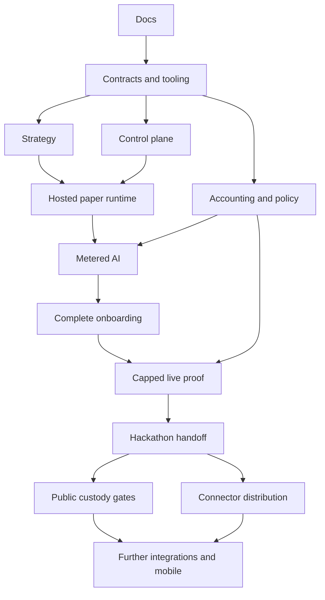

# Implementation plan

This plan is a handoff for a team, not a request to implement during the scaffold task. Gate status lives in [goals.md](goals.md). Work item status and named claims can be added here when implementation starts.

## Ownership and integration

| Workstream | Writable ownership | Prerequisites | Deliverable / handoff |
| --- | --- | --- | --- |
| Integration lead — unassigned | Root docs, gate status, workspace manifests/lockfile | G0 | Resolves shared contracts; merges verified slices |
| Contract/data owner — unassigned | `packages/contracts/`, initial migrations coordinated with API | G0 | Versioned schemas, fixtures, migration conventions before consumers |
| Strategy/editor owner — unassigned | `packages/strategy/`, Blockly integration in `apps/web/` by explicit handoff | G1 | AST/compiler/interpreter and preset contracts |
| Web/docs owner — unassigned | `apps/web/`, `apps/docs/`, `docs/guide/` | G1; G2 for final editor integration | Wizard, timeline, tutorial, public docs build |
| Control/runtime owner — unassigned | `apps/api/`, `apps/runtime/` | G1; G2 for interpreter | Durable lifecycle, event delivery, paper execution |
| Funds/security owner — unassigned | `packages/accounting/`, `packages/policy/`, `apps/executor/` | G1 | Ledger, policy, custody proof, effect recovery |
| Connector owner — unassigned | `packages/connectors/` | G1 | One chain-verified read/action route and normalized events |
| Operations/test owner — unassigned | `infra/`, `tests/` | G1; other modules for integration | Isolation, recovery checks, deployment and demo evidence |

These are roles, not required headcount. A smaller team combines roles. Before two contributors touch `apps/web/`, the current owner explicitly transfers the editor file scope; never run concurrent writers just because roles differ. Database migrations and schema changes have a single scheduled owner, even when several roles propose them.

## Build sequence

### Slice A: shared language before infrastructure

G1 defines contracts from the supplied examples and rejects invalid inputs. G2 implements compiler and pure interpreter using synthetic observations. In parallel after G1, API identity/drafts, accounting arithmetic/reservations, connector capability probes, and basic web form structure can proceed independently. Do not wait for paid cloud access to test language semantics.

Integration checkpoint: compile a preset, submit its canonical JSON to the API validator, and show the same errors in the editor. The schema owner signs off the trace. Paper execution needs no real deposit or production signer.

### Slice B: first hosted paper run

G3/G4 connect immutable deployments, Postgres jobs, a runtime process, simulated execution, and a minimal timeline. API worker owns ingestion; runtime owns evaluation; executor owns both paper and live intent disposition, with an explicit paper-only adapter that never loads signing credentials. Infrastructure provides an isolated task and capped lifetime.

Integration checkpoint: kill the runtime after it creates an intent and restart it. The same run/node identity returns the same effect. Reconnect the event feed and prove no duplicated fills. Pause prevents new actions while history remains inspectable.

### Slice C: economics and AI

G5 and G6 connect the financial and policy modules to provider access. Prove server-wallet policies and ambiguous-send recovery in a vendor sandbox before enabling any live signing role. Model calls reserve upper-bound cost before dispatch and keep uncertain charges held for reconciliation. Record priced versus actual usage for budget estimates.

Integration checkpoint: exhaust the model budget during an AI-gated strategy. It fails closed with a visible reason, cannot consume the hosting/trading bucket, and does not silently choose a fallback model. Verify provider-specific reasoning settings rather than treating them as universal.

### Slice D: complete user flow and live proof

G7 completes onboarding and tutorial against existing contracts, including deposits only in the gated live path. G8 uses a single verified swap pair and small team-owned funds. The UI displays exact permission limits, selected revision, custody model, budget recommendation assumptions, and irreversible transaction status.

Integration checkpoint: record allowed and rejected transactions, restart executor after broadcast, and reconcile both ledger and on-chain balances. If provider wallet/RPC/connector capabilities fail, keep the hosted demo paper-only and disclose the missing live gate; never simulate a receipt and call it on-chain success.

### Slice E: handoff and expansion

G9 packages demo evidence and public beginner docs. G10 is a separate operational/custodial launch effort. G11 extracts the already-used connectors into a documented self-hosted distribution. G12 adds capability families one at a time. Mobile and rich P&L charts depend on stable monitoring contracts rather than delaying the hackathon slice.

## Dependency map

## Definition of done for a work item

1. Claimed file scope and prerequisites are recorded; unrelated changes remain untouched.
2. Normative contract/example is updated before or with implementation.
3. Behavior works through the public module interface, including the relevant failure case.
4. Targeted checks run and their evidence is recorded; unrun checks are labeled unrun.
5. Secrets, third-party terms, pricing assumptions, and feature-gate defaults are reviewed where affected.
6. Local checklist is ticked with evidence; the integration owner decides whether the root gate is complete.

## Initial external probes

Before G5/G8, verify Privy policies and signing recovery; exact stablecoin/router/pool deployments and liquidity on Monad; finalized RPC semantics; cloud quotas and private egress enforcement; Kimi credentials/capabilities and Qwen region availability; the current sponsor portal and required integrations. The [decision register](docs/decisions.md) gives fallback behavior for each. These are bounded capability checks, not a reason to reopen the architecture wholesale.

No calendar deadline is inferred from conflicting public event listings. The team records the authenticated portal deadline before planning submission. Do not promise a production custody launch merely because the hackathon demo works.
