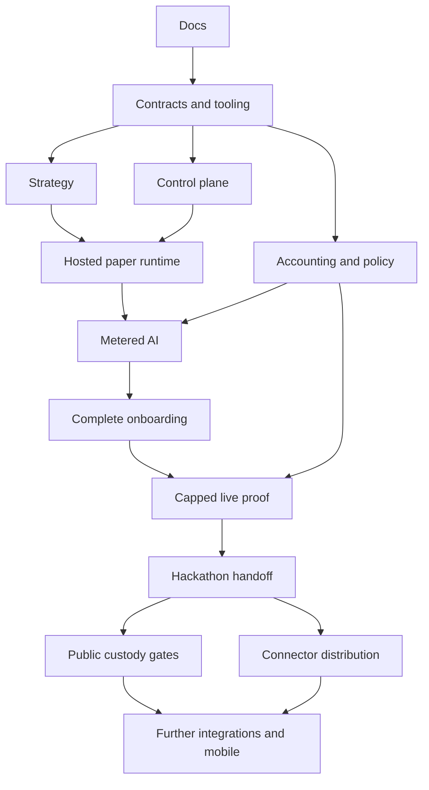

# Implementation plan

This plan is a handoff for a team, not a request to implement during the scaffold task. Gate status lives in [goals.md](goals.md). Work item status and named claims can be added here when implementation starts.

## Ownership and integration

| Workstream | Writable ownership | Prerequisites | Deliverable / handoff |
| --- | --- | --- | --- |
| Integration lead — unassigned | Root docs, gate status, workspace manifests/lockfile | G0 | Resolves shared contracts; merges verified slices |
| Contract/data owner — unassigned | `packages/contracts/`, initial migrations coordinated with API | G0 | Versioned schemas, fixtures, migration conventions before consumers |
| Strategy/editor owner — unassigned | `packages/strategy/`, Blockly integration in `apps/web/` by explicit handoff | G1 | AST/compiler/interpreter and preset contracts |
| Web/docs owner — unassigned | `apps/web/`, `apps/docs/`, `docs/guide/` | G1; G2 for final editor integration | Wizard, timeline, tutorial, public docs build |
| Control/runtime owner — unassigned | `apps/api/`, `apps/runtime/` | G1; G2 for interpreter | Durable lifecycle, event delivery, paper execution |
| Funds/security owner — unassigned | `packages/accounting/`, `packages/policy/`, `apps/executor/` | G1 | Ledger, policy, custody proof, effect recovery |
| Connector owner — unassigned | `packages/connectors/` | G1 | One chain-verified read/action route and normalized events |
| Operations/test owner — unassigned | `infra/`, `tests/` | G1; other modules for integration | Isolation, recovery checks, deployment and demo evidence |

### Active claims

Codex, 2026-10-08 — `codex/user-app-control-api` in `monad-hack-fork`: sole writer for `apps/web/`, `apps/api/` including migration `0002_control_workspace.sql`, control-workspace contracts in `packages/contracts/`, root scripts/lockfile and implementation documentation. User requested the React/Blockly app and Fastify validation/budget blocks. G1/G2 are the baseline. Runtime, executor, provider wallets and root gate status are outside this slice. The user transfers the existing editor scope for this integration.

| Work item | Branch | Writable scope | Prerequisites |
| --- | --- | --- | --- |
| G3 control-plane hardening (umbrella #15: #16 auth, #17 quotas, #18 catalog resolution, #19 failure reasons/retention, #20 drain-before-stop; API-1, API-2, API-6, API-7, INF-4) — TathagatGupta98, 2026-10-12 | `feat/g3-control-plane-hardening` (uncommitted; the owner reviews and commits) | Migrations `0006`–`0009` (sole writer; the executor owner's next migration moves after these); `apps/api/src/` (`lifecycle.ts`, `app.ts`, `control.ts`, new `catalog.ts`, `auth/`, hosted entry point, `runtime-control/store.ts` stop/fan-out/quota), `apps/api/src/db/seed.ts` catalog versions; `packages/contracts` reason vocabulary, error codes and `deployment-manifest/2` (contract-owner approval); `apps/web/src/OperatePanel.tsx` and login; matching spec sections, D37 and checklist evidence | G1, G2, PR #2 (`9a4d0d7`). Order: #18 → #16 → #19 → #17 → #20. Identity provider for #16: Privy (owner's choice 2026-10-13; API side only, web login later). #18 done 2026-10-13 (uncommitted): migration `0006_catalog_pins.sql`, `apps/api/src/catalog.ts`, `deployment-manifest/2` (approved by the owner acting as contract owner), seed `1.1.0` rows, D42; `REQUIRE_DB=1 pnpm check` 533/534 twice (only failure: directory-rule test on the untracked `media/` folder), stack smoke on a scratch database. #16 done 2026-10-13 (uncommitted): migration `0007_identities.sql`, `apps/api/src/auth/`, `apps/api/src/hosted.ts` (`pnpm api:hosted`), D43, [hosted-auth.test.ts](tests/hosted-auth.test.ts); hosted web login not started. #19 done 2026-10-13 (uncommitted): migration `0008_audit_retention.sql`, `packages/contracts/src/reasons.ts`, `CURSOR_EXPIRED`, `pnpm db:prune`, Operate reasons and reset, D44; `REQUIRE_DB=1 pnpm check` 552/553 (only failure: the `media/` directory-rule test). Next: #17 (migration `0009`). |
| Runtime contracts and local agent runtime (G4 Phase 1) — yash, 2026-10-07 | `master` | `packages/contracts/` (runtime schemas in `schemas/`, `common`/`error-1` additions, `src/keys.ts`, `index.ts`, `generate.mjs`, fixtures, tests), `apps/runtime/` (`package.json`, `src/`), root `package.json` `runtime:demo` script and lockfile entries, `docs/integration/`, runtime sections of `docs/specs/agent-runtime.md`, `executor.md` §3–4, `api-and-data.md` §9, `connectors.md`, `runtime.md`, `docs/decisions.md` D32–D34/E10 | G1, G2. Key decision: option 1 (runtime maps interpreter keys to `operation-key/1`/`intent-key/1`; `packages/strategy` unchanged). Done 2026-10-07: `pnpm check` and `pnpm runtime:demo` green; local stand-ins pass both conformance kits. Real API/executor/broker integration and hosting remain open. |
| Funds and policy track #29 (ACC-1–ACC-6, POL-2–POL-5, EXE-2 harness, EXE-7, WEB-6 partial) — yash, 2026-10-12 | `feat/funds-policy` | Migrations `0008_accounting_ledger.sql`, `0009_custody_billing.sql` and `0010_executor_live.sql`, renumbered after the market-data migrations 0006/0007, and `0011_live_transactions.sql` for the live Uniswap route on `feat/live-uniswap` (broker integration reserves 0012–0017; the next free migration is **0018**); `packages/accounting/`; `packages/policy/` (`action-policy/2`, live context blocks; paper call sites unchanged); new `packages/custody/`; `packages/contracts` `funds-1`; `apps/api/src/funds.ts`, `funds-config.ts`, funds routes in `app.ts`/`server.ts`, `meterHosting` in `runtime-control/`; `apps/web/src/FundsPanel.tsx`; `scripts/custody-proof.ts`, `stack-dev.mjs` local custody; tests `accounting`, `custody`, `funds-api`, `scratch-db.ts`; decisions D44–D48, E03 progress; [funds guide](docs/integration/funds.md) | Done at the project owner's request and to be relayed to the executor owner (vihaan1016): live admission and ledger transitions in `apps/executor/src/live.ts`, live wiring in `service.ts`/`index.ts`/`testing.ts`, `IntentRow` live fields and paper-only recovery in `store.ts`, mode-aware `catalogAllows`, test `executor-live.test.ts`, D49. Paper behaviour unchanged. The signing pipeline (#39–#41) remains. Privy evidence (E03), the funding stablecoin (E04), RPCs (E06) and real prices (E05) need the project owner's accounts. |
| Deployment lifecycle, executor integration and history (API-2, API-6, EXE-1 wiring, INT-2, WEB-5 partial) — yash, 2026-10-12 | `feat/lifecycle-executor-integration` | Migration `0005_deployment_lifecycle.sql`; `apps/api/src/lifecycle.ts`, `app.ts` and `server.ts` lifecycle routes, `runtime-control/` (vocabulary, manifest, audit, exchange, outbox, stop, observations, synthetic feed); `apps/executor/src/` (`authority.ts`, `market.ts`, `main.ts`, capability re-export, harness deployments row); `packages/contracts` (capability helpers moved here, `audience-capability-1`, `deployment-manifest-1`, `audit-event-2`, `control-lifecycle-1`); `apps/runtime/src/` (`dispatch/executor.ts`, `dispatch/ids.ts`, exchange in the control client, `main.ts`, endpoint config); `apps/web/src/OperatePanel.tsx` and Operate stage; seed catalog additions; `scripts/stack-dev.mjs`; tests `paper-stack.test.ts`, executor conformance through the real client; decisions D37–D41 and guides | Changes in the executor owner's (vihaan1016) area were made at the project owner's request and are to be relayed by the project owner: `capability.ts` moved to `@monad-hack/contracts/capability` (re-exported), `authority.ts`, `market.ts` and `main.ts` added, the test harness inserts a `deployments` row, the intents → deployments FK is in migration 0005 (their next migration is 0006). Done 2026-10-12: `REQUIRE_DB=1 pnpm check` 518 pass, 0 skipped (two runs); web build green; `pnpm stack:dev` boots all services. |
| Runtime-facing control API (API-3 partial, INT-1) — yash, 2026-10-08 | `feat/runtime-control-api` | `apps/api/src/runtime-control/`, `apps/api/migrations/0003_runtime_control.sql` (stacked on PR #1, whose `0002_control_workspace.sql` comes first), `apps/api/src/db/db.test.ts` (0002 checks, migration list derived from files), `apps/api/package.json` (`@monad-hack/strategy`, `fastify` 5.12.5 as in PR #1), `apps/runtime/src/dispatch/`, runtime offer v2 and revoke-on-resume changes, `packages/contracts` (`artifact-1`, `assignment-offer-2`, `runtime-heartbeat-1`, `runtime-lease-1`, `capabilityGrant`, `INTERNAL_ERROR`), `packages/strategy` `runIdentity` export, `tests/runtime-control.test.ts`, root `package.json` (`api:runtime`, `pg` dev dependency), integration guides | Runtime commits on `master`. Creates a minimal `deployments` and `trigger_state`; the API-2 lifecycle owner extends them rather than adding parallel tables. Done 2026-10-08: `REQUIRE_DB=1 pnpm check` 426 pass, 0 skipped. |
| G4 paper executor (EXE-1, POL-1 progress, INT-2 progress) — vihaan1016, 2026-10-08 | `master` | `apps/executor/` (`package.json`, `src/`), `packages/policy/` (`package.json`, `src/`), migration `apps/api/migrations/0004_executor_paper.sql` plus its checks in `apps/api/src/db/db.test.ts`, `tests/executor-conformance.test.ts`, the conformance strategy and node choices in `apps/runtime/src/conformance/executor.ts` (kit only; harness contract agreed through `docs/integration/executor.md`), executor sections of `docs/integration/`, executor status line in `docs/specs/executor.md` §18, `docs/decisions.md` D35–D36, lockfile entries for executor/policy | G1, G2, runtime contracts `355fa70`. Deployment authority, capability issuance and broker-result evidence are control-API (G3) inputs consumed through ports. Upstream `0003_runtime_control.sql` adds a minimal `deployments` table, but it does not yet carry everything `AuthoritySource` needs (see [executor integration §3a](docs/integration/executor.md#3a-capability-and-deployment-authority)), and its per-assignment bearer is not the executor capability (D35). Progress 2026-10-08: `REQUIRE_DB=1 pnpm check` 421/421 (four consecutive runs, Postgres 17.11); runtime executor kit 7/7 over HTTP. 2026-10-09: rebased onto `63d353e`; migration renumbered `0002` → `0004` after upstream `0002_control_workspace`/`0003_runtime_control`; `REQUIRE_DB=1 pnpm check` 481/481, 0 skipped (executor/policy/DB subset 57/57). EXE-1 and INT-2 stay open for the G3 inputs. |
| Agent-runtime specification consolidation — Codex, 2026-10-07 | working tree for owner review | `docs/specs/agent-runtime.md`, documentation navigation and runtime/executor cross-links only; no implementation, schema, migration or gate completion | Existing G1/G2 baseline; owner requested a detailed runtime implementation specification |
| Executor specification consolidation — Codex, 2026-10-07 | working tree for owner review | `docs/specs/executor.md`, documentation navigation and executor/API cross-links only; no implementation, schema, migration or gate completion | Existing G1/G2 baseline; owner requested a non-MCP hosted executor specification |
| G1 workspace skeleton (PKG-1, APPS-1, INF-1 progress; CI-1) | `master` | Root manifests, `pnpm-lock.yaml`, `tsconfig.json`, `.node-version`, `.env.example`, stub `package.json` per app/package, `infra/compose.yaml`, `.github/`, `tests/workspace.test.ts` | G0 |
| Strategy-language implementation research — Codex, 2026-10-02 | `master` (owner requested scoped commit and push) | `docs/research/strategy-language-build-guide.md`, strategy coverage research, language scope clarification, documentation navigation and this claim | Research complete; documentation links and diff checks passed. Current `strategy/1` remains authoritative. No code, dependency, language expansion or gate completion implied. |
| G1 completion: contracts (CON-1–3), migrations and paper seed data, secrets checks, startup path (API-1, CI-2, TEST-1, SPEC-1 progress) — TathagatGupta98, 2026-10-03 | `master` (uncommitted; the owner reviews and commits) | `packages/contracts/` (`schemas/`, `fixtures/`, `canonical.ts`, `contracts.test.ts`; merged edits to the language core's `index.ts`, `generate.mjs` and `strategy.schema.json` Amount/Money/Price), `apps/api/` (migrations, seeds, DB/config code), root `package.json` scripts, `pnpm-lock.yaml`, `.gitignore`, `.github/workflows/ci.yml`, `tests/`, `docs/specs/api-and-data.md` section 9, one line in `docs/specs/strategy-language.md` section 9, `design.md` and `AGENTS.md` (directory rule), README setup, progress notes | G0; language core `a773b02` (its strategy schema stays authoritative). Restored from the 2026-10-02 work; `pnpm bootstrap` → 244/244 pass, 0 skipped on 2026-10-03. Complete 2026-10-03: commit `5d94ea3`, [green hosted CI](https://github.com/AnInsaneJimJam/monad-hack/actions/runs/37137630518/job/111245284126); G1 ticked in goals.md. |
| G2 Blockly strategy editor — TathagatGupta98, 2026-10-03 | `master` (changes left uncommitted; the owner reviews and commits manually) | `apps/web/`; `packages/strategy/src/workspace/`; small catalog/schema edits in `packages/strategy/src/compile.ts`, `packages/strategy/src/strategy.test.ts` and `packages/contracts/src/strategy.schema.json` (editor plan Phase 1); Phase 8 engine work in `packages/strategy/src/` (`compile.ts`, `expression.ts`, `interpreter.ts`, `index.ts`, tests) and the run-checkpoint definitions of `strategy.schema.json` plus the `Binding`/`TextValue` type exports in `packages/contracts/src/index.ts`; root lockfile entries, root `tsconfig.json` exclusion and web scripts only; editor sections of `docs/specs/strategy-language.md`, `docs/specs/product.md` and decisions D14–D31 | G1 (open; G2 cannot be ticked before it closes) and language core `a773b02`. Phase 0: records only, versions rechecked 2026-10-03. Phase 3 (blocks, shared units/vocabulary) done 2026-10-03: `pnpm check` and web `build` green. Phase 4 (workspace ↔ strategy converter) done 2026-10-03: 32 tests green. Phases 5–6 (live validation, rookie/advanced limits, two presets, tutorial) done 2026-10-03: 35 tests, web `typecheck`/`build` green and a Chrome check. Phase 7 (synthetic Rehearse panel; `Catalog.networks` block cadence 300 ms / 2-block finality from docs.monad.xyz, rechecked 2026-10-03) done 2026-10-03: 41 tests, web `typecheck`/`build` green. Phase 8 (named values, `read`, `ai.decide`, `strategy-run/2` checkpoints, all four presets, scripted-AI rehearsal) done 2026-10-03: 45 language/workspace/rehearsal tests (`pnpm check` 252/252), web `typecheck`/`build` green, `pnpm strategy:demo` unchanged and a Chrome check. Phases 9–10 (keyboard outline, keyboard-only Playwright test in `apps/web/e2e/`, G2 evidence) done 2026-10-04: `pnpm check` 252/252, web `build` green, Playwright 1/1, demo unchanged; STR-1–4/6 and WEB-2 ticked. G2 ticked 2026-10-04 after hosted CI passed on commit `71467bf`. |

Language core implementation — Codex, 2026-10-02: branch `codex/g2-strategy-core`; sole writer for `packages/contracts`, `packages/strategy`, root manifests/lockfile/tsconfig, README, language specification and local checklist evidence. Prerequisite G0 and workspace skeleton. Implemented first deliverable: closed strategy schema and generated types, bounded AST validation, exact expression evaluation, price/schedule transitions, resumable synthetic threshold run. Verification: `pnpm check` (17 tests plus strict types) and `pnpm strategy:demo` (one intent, waits for synthetic settlement). See [language core tests](packages/strategy/src/strategy.test.ts). Blockly, read/AI/event catalog integration and root gate completion remain pending.

These are roles, not required headcount. A smaller team combines roles. Before two contributors touch `apps/web/`, the current owner explicitly transfers the editor file scope; never run concurrent writers just because roles differ. Database migrations and schema changes have a single scheduled owner, even when several roles propose them.

## Build sequence

### Slice A: shared language before infrastructure

G1 defines contracts from the supplied examples and rejects invalid inputs. G2 implements compiler and pure interpreter using synthetic observations. In parallel after G1, API identity/drafts, accounting arithmetic/reservations, connector capability probes, and basic web form structure can proceed independently. Do not wait for paid cloud access to test language semantics.

Integration checkpoint: compile a preset, submit its canonical JSON to the API validator, and show the same errors in the editor. The schema owner signs off the trace. Paper execution needs no real deposit or production signer.

### Slice B: first hosted paper run

G3/G4 connect immutable deployments, Postgres jobs, a runtime process, simulated execution, and a minimal timeline. API worker owns ingestion; runtime owns evaluation; executor owns both paper and live intent disposition, with an explicit paper-only adapter that never loads signing credentials. Infrastructure provides an isolated task and capped lifetime.

Integration checkpoint: kill the runtime after it creates an intent and restart it. The same run/node identity returns the same effect. Reconnect the event feed and prove no duplicated fills. Pause prevents new actions while history remains inspectable.

### Slice C: economics and AI

G5 and G6 connect the financial and policy modules to provider access. Prove server-wallet policies and ambiguous-send recovery in a vendor sandbox before enabling any live signing role. Model calls reserve upper-bound cost before dispatch and keep uncertain charges held for reconciliation. Record priced versus actual usage for budget estimates.

Integration checkpoint: exhaust the model budget during an AI-gated strategy. It fails closed with a visible reason, cannot consume the hosting/trading bucket, and does not silently choose a fallback model. Verify provider-specific reasoning settings rather than treating them as universal.

### Slice D: complete user flow and live proof

G7 completes onboarding and tutorial against existing contracts, including deposits only in the gated live path. G8 uses a single verified swap pair and small team-owned funds. The UI displays exact permission limits, selected revision, custody model, budget recommendation assumptions, and irreversible transaction status.

Integration checkpoint: record allowed and rejected transactions, restart executor after broadcast, and reconcile both ledger and on-chain balances. If provider wallet/RPC/connector capabilities fail, keep the hosted demo paper-only and disclose the missing live gate; never simulate a receipt and call it on-chain success.

### Slice E: handoff and expansion

G9 packages demo evidence and public beginner docs. G10 is a separate operational/custodial launch effort. G11 extracts the already-used connectors into a documented self-hosted distribution. G12 adds capability families one at a time. Mobile and rich P&L charts depend on stable monitoring contracts rather than delaying the hackathon slice.

## Dependency map

## Definition of done for a work item

1. Claimed file scope and prerequisites are recorded; unrelated changes remain untouched.
2. Normative contract/example is updated before or with implementation.
3. Behavior works through the public module interface, including the relevant failure case.
4. Targeted checks run and their evidence is recorded; unrun checks are labeled unrun.
5. Secrets, third-party terms, pricing assumptions, and feature-gate defaults are reviewed where affected.
6. Local checklist is ticked with evidence; the integration owner decides whether the root gate is complete.

## Initial external probes

Before G5/G8, verify Privy policies and signing recovery; exact stablecoin/router/pool deployments and liquidity on Monad; finalized RPC semantics; cloud quotas and private egress enforcement; Kimi credentials/capabilities and Qwen region availability; the current sponsor portal and required integrations. The [decision register](docs/decisions.md) gives fallback behavior for each. These are bounded capability checks, not a reason to reopen the architecture wholesale.

No calendar deadline is inferred from conflicting public event listings. The team records the authenticated portal deadline before planning submission. Do not promise a production custody launch merely because the hackathon demo works.

Tooling fix — Codex, 2026-10-03: owns root runtime manifest/lockfile and setup instructions. Reproduced `pnpm strategy:demo` using an incompatible Node runtime. Fixed with exact Node 24.21.0 in `devEngines.runtime` (`onFail: download`) and the runtime checksum in the lockfile. Normal `pnpm install --frozen-lockfile`, `pnpm strategy:demo` and `pnpm check` verified; 17 checks pass. Setup instructions updated; strategy/research changes preserved.

## Local control workspace — 2026-10-08

Visual redesign — Codex, 2026-10-08: owns `apps/web/` presentation, Blockly theme and this evidence note on `codex/user-app-control-api`. Rebuilt as a graphite strategy workbench with selected parameters first, AST-derived market/trigger/run scope, mineral Blockly colors and readable fields, matching rehearsal charts, restrained motion and reduced-motion support. Phone-sized screens start with rule forms. Language, API and financial boundaries are preserved. [Figma visual direction](https://www.figma.com/design/t3uXhn26g3TvM0GmjRhk6u). Evidence: 267 checks pass with no skipped PostgreSQL tests; production build passes; CUA verifies keyboard threshold edits update scope, revision 4 saves and reopens, mobile Saved drawer and Rules, one crossing/one simulated settlement, no page overflow at 320/768/1024px and desktop composition at 1440px. No fresh-page console errors. Existing Playwright runner remains unrun.

Branch `codex/user-app-control-api`, cloned fork in `monad-hack-fork`, baseline `fe710ce` (fork/upstream both current).

- [x] Fastify validation/save routes, schema-derived control contracts and migration 0002: tenant ownership, immutable revisions, exact paper configuration limits, transactional idempotency and optimistic concurrency.
- [x] React/Blockly Build → Rehearse → Review workspace, local session, save/reopen, keyboard rule forms, responsive Saved library, source-focused errors and immediate validation invalidation.
- [x] Verification: `REQUIRE_DB=1 pnpm check` → 267 passed, zero skipped against isolated PostgreSQL; web production build passed.
- [x] Browser verification through CUA: revision saved/reloaded with a 1,250 virtual USD trading limit; zero threshold rejected; rookie slippage 80 bps blocks Save and its error focuses the field; 50 bps restores validity; zero trading budget blocks Save; rapid edit/revert recovers validation; one crossing produces one simulated trade; keyboard Tab reaches playback; no page overflow at 320/768/1024 px, desktop checked at 1440 px, mobile Saved and Rules work.
- [ ] The updated Playwright regression file is retained for CI; its runner was not executed during this task. Browser checks above were performed through CUA.
- [ ] Hosted identity, runtime/executor, actual paper fills, wallets, financial allocations/reservations and billable estimates are separate integration work. No root gate completion claimed.

See [control-workspace contracts and setup](docs/specs/control-workspace.md). Browser checks use synthetic data. Local environment, database volumes, logs, generated types, build output and screenshots remain ignored/local.

Review fixes — Codex, 2026-10-08: owns API request/error handling, control contract registration/version tests, corresponding specifications and error fixtures. Prerequisites: upstream runtime contracts integrated without losing control transports; no migration changes. Resolve session once per request, separate internal faults from connection outages, accept both local loopback frontend origins, and cover version pins inside definitions. Evidence: upstream `9fb4f4b` integrated; `REQUIRE_DB=1 pnpm check` passes 403 tests, zero skipped, including real PostgreSQL persistence/tenant checks and the new request-boundary regressions. Web production build passes. Per-process rate limiting remains explicitly local; shared hosted ingress limiting is pending.

## Broker-AI issue #4 — 2026-10-13

Codex owns `apps/api/src/broker-store.ts`, migration `0012_broker_results.sql`, persisted-result schema/fixtures, their contract registrations and PostgreSQL tests. Prerequisite: upstream `9a4d0d7`. Scope is immutable result persistence/readback and operation-key replay; HTTP, providers and billing belong to dependent issues. External calls run after the durable dispatch claim commits; ambiguous dispatch is never repeated. Evidence: `REQUIRE_DB=1 pnpm check` → 525 passed, zero skipped; `broker-store.test.ts` covers concurrency, restart, unknown reconciliation, immutable records and scoped readback; `db.test.ts` verifies waiting-operation ownership and result-pointer constraints.

## Broker-AI issue #5 — 2026-10-13

Codex owns the paper broker service, broker-audience capability exchange/verification, internal route wiring and broker conformance tests. Depends on #4 (`f1148ff`). Read side uses persisted market observations with catalog units/freshness; AI is explicitly synthetic. Real provider billing remains #8/#9. Evidence: `REQUIRE_DB=1 pnpm check` 534 passed, zero skipped. Broker conformance runs through Fastify on PostgreSQL; safety checks cover cross-audience/expired/other-run tokens, missing observations, approved command fields, malicious AI output and reconciliation with exactly one durable resume. Executor audience regression updated for the expanded issuer.

## Broker-AI issue #6 — 2026-10-13

Codex owns `apps/runtime/src/dispatch/broker.ts`, broker capability caching, runtime endpoint/main wiring, `scripts/stack-dev.mjs` and HTTP-client conformance/regression tests. Depends on #5 (`73e7a53`). Scope: use the API broker with identical-body retry, bounded transport and UUIDv7 tracing. Evidence: `REQUIRE_DB=1 pnpm check` 542 passed, zero skipped; real-service broker conformance and full HTTP paper stack pass. `pnpm stack:dev` boots all five services with HTTP broker; stopped after verification.

## Broker-AI #7 — 2026-10-13
Codex owns executor branch-evidence verification, scoped PostgreSQL evidence reads and paper admission scenarios. Depends on #6. Reconstruct from immutable run/artifact identity and referenced broker responses through the shared pure interpreter; never trust runtime checkpoint bindings. No live enablement or unrelated executor behavior. Evidence: `REQUIRE_DB=1 pnpm check` 546 passed, zero skipped; executor-paper scenarios verify complete, missing, contradictory and foreign-run records before reservation; full paper HTTP stack remains green.

## Broker-AI #8 — 2026-10-13
Codex owns the Kimi adapter, broker-only opt-in wiring, durable AI metering and migration `0013_ai_metering.sql`, plus bounded-output/timeout/unknown-charge checks. Depends on #7. User explicitly chose implementation and synthetic verification, leaving paid E05 verification gated. No API keys are configured and no paid calls are authorized. Published model/rates are research evidence only; daily per-agent quota is #9. Evidence: `REQUIRE_DB=1 pnpm check` 558 passed, zero skipped, with synthetic provider transport only. Covers closed decision/summary outputs, actual abort, rate rounding, immutable charge, concurrent replay, post-metering crash and unknown-charge reconciliation. E05 remains explicitly unverified.

## Broker-AI #9 — 2026-10-13
Codex owns migration `0014_ai_allowances.sql`, atomic paper AI allowances, pre-dispatch integration and user-visible budget refusal, with concurrency/replay/window checks on PostgreSQL. Depends on #8 implementation; E05 stays gated. Default daily limits are 20 calls and 100,000 micro-USD, further restricted by the agent's API allocation. Trading and hosting balances are never touched. Evidence: `REQUIRE_DB=1 pnpm check` 566 passed, zero skipped. PostgreSQL tests prove the 20-call race, daily USD ceiling, tenant/agent isolation, UTC rollover, legacy backfill, visible budget failure and runtime death/resume with one provider call and one charge. All provider transports are synthetic; E05 remains gated.
#9 also owns forward migration `0015_ai_allowance_backfill.sql`: preserve pre-existing metered charges/holds and prior synthetic call counts when introducing allowances. The original broker allowance migration has already run in scratch tests and remains unchanged.

Broker review follow-up: Codex owns forward migration `0016_broker_storage_bounds.sql`. Upstream migration 0006 remains unchanged; the original broker migration was renumbered with explicit user approval. Preserve compact protocol limits while allowing PostgreSQL JSONB formatting overhead in storage; verify near-limit persistence and database ceilings.

#9 review follow-up owns forward migration `0017_ai_backfill_call_counts.sql`: preserve legacy audit claims while excluding known pre-dispatch refusals from call counts. Atomically commit Kimi allowance and metering claims; add synthetic-path and interrupted-claim regressions.

Final review evidence: `REQUIRE_DB=1 pnpm check` → 576 passed, zero skipped. Includes terminal-dispatch and reconciliation races, downstream authored failures, malformed HTTP errors, expired/future executor observations, compact JSON boundary persistence, atomic allowance/metering rollback, legacy refusal correction and the distinct zero-cost synthetic quota path. Real-provider E05 remains gated.
## Issue #10 — market-data ingestion (2026-10-12)

Codex owns branch `codex/issue-10-market-data` based on `9a4d0d7`: connector manifests/registry/adapters in `packages/connectors`, observation contracts and fixtures in `packages/contracts`, API ingestion worker and migration 0006, venue-aware paper quotes in executor, strategy/editor catalog integration for Curve, stack configuration, regression checks and affected specs/evidence. Children #11 → #12 → #13 → #14 remain sequential. User direction: Uniswap and Curve mainnet observations with paper execution; no synthetic market-feed fallback. Quotes/swaps and liquidity management on-chain are outside this issue. Research owns only `docs/research/market-data-sources.md` and has completed. Baseline `REQUIRE_DB=1 pnpm check`: 518 pass, 0 skipped. Provider, exact pools and normalized price semantics must be verified before enablement; no secrets or paid calls, accounts, commits, pushes or issue updates.

Scope update 2026-10-12: the user selected exactly three initial connectors: **Aave, Uniswap, Curve**. Aave adds native USD prices and supply/variable-borrow reserve rates for reviewed USDC/AUSD reserves; supply, borrow, repay and withdraw actions are deferred. Uniswap/Curve retain mainnet observations and paper swaps. The scoped finalized-price read route overlaps only the read portion of #5; broker-audience capabilities, model calls and full broker conformance remain #5. Live route/build/signing remains #38–42; capability-selection UI remains #44. Migration 0006 has been applied locally and must not be edited further.

Codex additionally owns forward migration 0007 for the finalized-observation lookup index and tenant ownership of replayed market reads; prerequisite: immutable migration 0006 already applied. No other migration writer is active.

### Verified handoff — 2026-10-13

- [x] #11 local acceptance: three versioned capability manifests match the curated strategy catalog and immutable seed versions; closed observation schema records native method, units, finality and provenance. CNR-1 is ticked.
- [x] #12 local acceptance: direct Monad finalized RPC and WSS wakeups selected; dated source/deployment probes and latency limits recorded in [research evidence](docs/research/market-data-sources.md) and E10. No Envio account needed.
- [x] #13 local acceptance: per-feed durable cursors, 100-block canonical replay, protocol log decoding, immutable observations, duplicate/crash recovery and quiet-feed heartbeats. Current finalized heartbeats continue during long historical recovery; historical ranges are not skipped. PostgreSQL regressions cover this behavior.
- [x] #14 local acceptance: `stack:dev` uses real sources without synthetic fallback; recorded mainnet crossings execute one paper threshold sale on both Uniswap and Curve. Source ingestion and runtime stages through first dispatch are emitted separately. Fixture replay explicitly substitutes the test clock and is not a measurement of production latency.

Verification: `REQUIRE_DB=1 pnpm check` **545 passed, 0 failed, 0 skipped**; web typecheck and production build pass; `git diff --check` passes. Browser checks confirmed eight native presets, correct Uniswap TWAP / Curve EMA labels, Aave price plus reserve APR reads with zero trades, connected local API and no browser console errors. Vite still reports the existing large-bundle advisory (~1.28 MB minified); this is not a build failure.

A fresh `pnpm market:probe` verified all three protocols/four feeds at finalized block 112909987 (2026-10-13 UTC). The running stack has acknowledged WSS and supplies current finalized heartbeats while catching up its existing cursor backlog. No root hosted G4/G8 completion, production latency percentile, live route, transaction signing or lending action is claimed. Full API broker remains #5; live route verification/build/simulation #38–39, live effects/recovery #40–42, capability-selection UI #44. Implementation and verification were completed on `codex/issue-10-market-data` before the user authorized PR publication. GitHub issue status is unchanged until the PR is merged.

Final running-stack smoke: API and web return HTTP 200; `/v1/catalog` reports `synthetic:false` and only `paper.uniswap`, `paper.curve`, `paper.aave`. All four finalized feeds were 5–7 seconds old at the check. No user strategy was created or launched for this smoke. Services remain on 3001/3002/3003/5173 with PostgreSQL on 5432.

### PR #58 Greptile follow-up — 2026-10-13

All four review findings were confirmed and addressed. Fresh finalized-head reads now have an independent runtime lane and advisory lock, so a stalled or failing historical oracle read cannot block quiet-feed refresh or skip its recovery cursor. Failure records include safe application-owned reason codes, phase and feed reference without provider URLs or messages. The keyboard-only browser test now selects and edits the native WMON threshold preset and verifies the truthful unavailable-playback explanation. Migration checks for 0006/0007 now live in `apps/api/src/db/db.test.ts`, covering constraints, immutability, read ownership/cross-tenant rejection, a real existing-row upgrade and migration idempotence; applied migration files were not changed.

Verification: `REQUIRE_DB=1 pnpm check` **550 passed, 0 failed, 0 skipped**; Playwright keyboard-only flow **1 passed**. Regression checks exercise two fresh heads during a deliberately blocked historical read, its later failure with the recovery cursor unchanged, distinguishable failure codes and secret-like URL exclusion. Browser verification required installing the pinned Chromium headless shell locally. No strategy was launched or real transaction sent.

Restarted-stack smoke: API/web HTTP 200, `synthetic:false`, exactly the three selected connectors, all four feeds 4–7 seconds old. A recovery source/storage failure was observed with its safe feed/phase code while refresh continued; provider history availability remains an operational limitation and no recovery range was skipped.

Greptile re-review ownership — 2026-10-13: Codex owns `market-ingestion.ts`, its PostgreSQL regression tests and affected runtime/connector/source documentation. Separate current-head cache persistence from the ordered trigger stream; keep recovery cursor, immutability, deduplication and freshness rules. No migration or contract changes are required. Acceptance: a still-fresh crossing followed by a return must fire once even when refresh completes first; cached reads must remain current during stalled recovery.

Re-review completion: current-head refresh is now cache-only; only canonical, ordered recovery events/checkpoints call trigger fan-out. This supersedes the earlier follow-up’s claim that independent refresh itself reaches fan-out. Telemetry labels `cache-only` versus `ordered-recovery` and leaves fan-out completion absent for cache-only observations. The deterministic regression first failed with zero crossings instead of one, then passed with exactly one crossing, event order preserved and no replay after cursor advancement. The stalled-recovery regression also verifies two cached heads with no trigger advancement. `REQUIRE_DB=1 pnpm check`: **551 passed, 0 failed, 0 skipped**; `git diff --check` passed. Checks used a disposable PostgreSQL 17.11 instance on port 55432 because the original Docker database was absent and the service on 5432 rejected repo credentials; existing services/data were untouched. No browser rerun was needed for this API-only change. Recovery outages may delay triggers beyond freshness bounds; stale trades remain refused.

Final merge validation 2026-10-13: integrated upstream bfc7c65 without changing migrations 0001–0011. Broker migrations are 0012–0017 per explicit user authorization. REQUIRE_DB=1 pnpm check passed 705 tests, zero skipped, on fresh scratch databases; native Uniswap/Curve/Aave end-to-end scenarios now use the HTTP broker rather than the earlier market-read adapter. Web production build passed. Paid Kimi E05 remains unverified and gated; merging its implementation does not close that evidence requirement.
